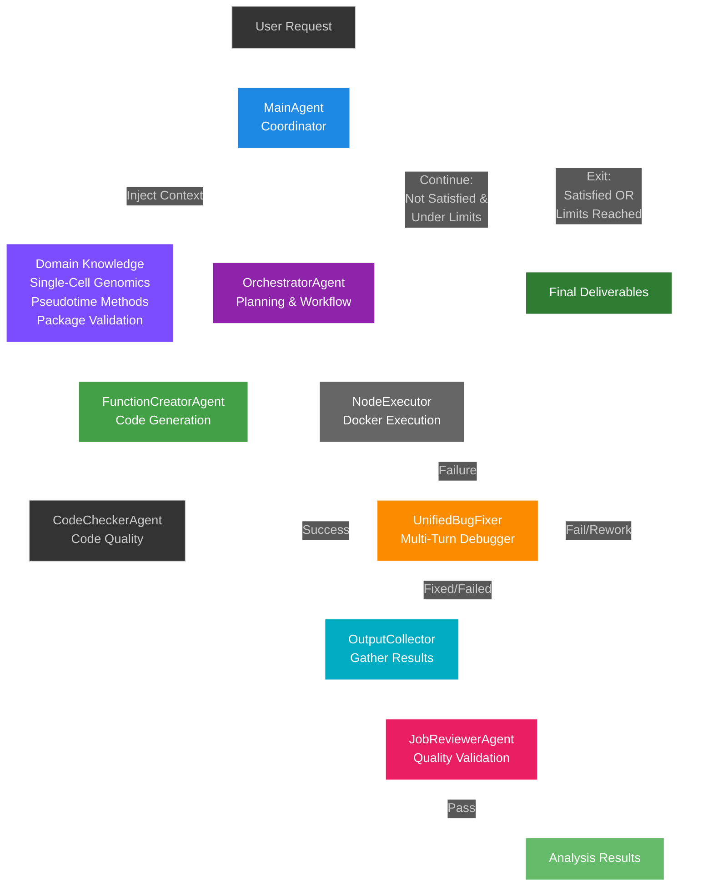
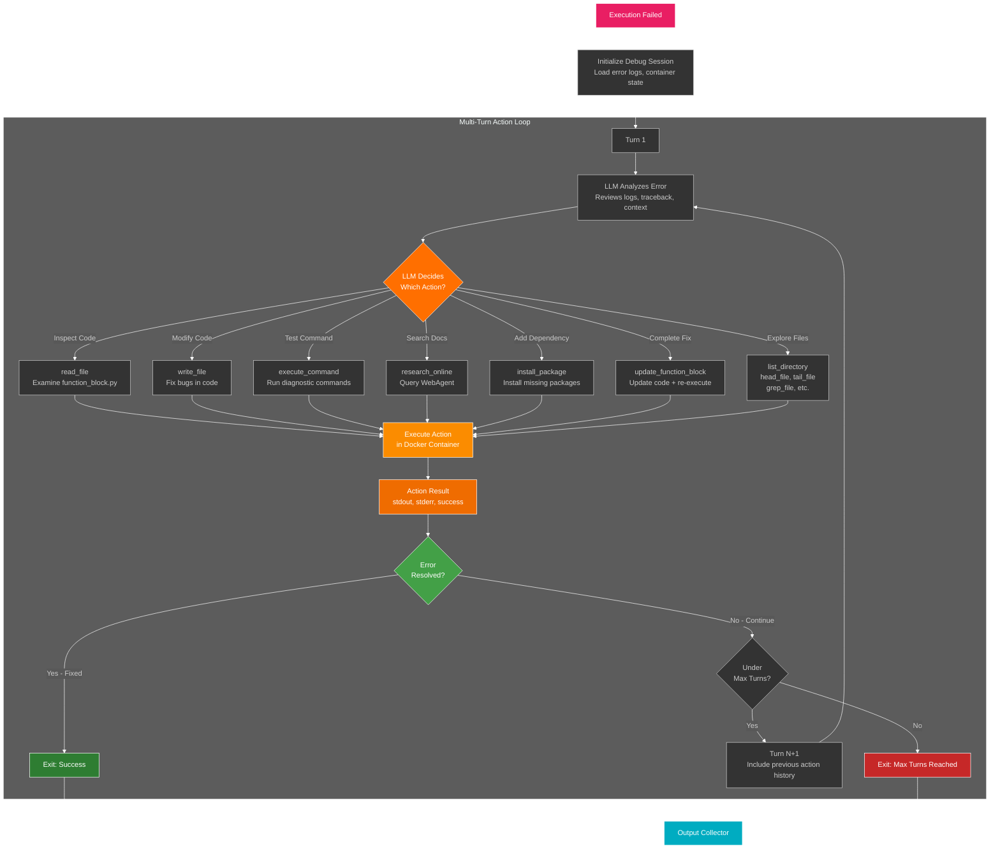

# OmiCairn Agent Local

> **Early-stage research release.** This repository contains an early research prototype of the system that later
> became OmiCairn. It is provided as-is for transparency and reproducibility, may contain bugs, is not maintained
> for production use, and its interfaces may differ from later versions. LLM-generated code is executed inside
> Docker containers; run it only on trusted data and hosts, without production credentials.

A hierarchical single-cell genomics analysis system using LLM-guided function blocks with Docker container isolation. The system automatically creates analysis trees where each node represents an isolated, reproducible computational step, enabling flexible multi-omics data analysis workflows.

## Table of Contents

- [Overview](#overview)
- [Key Features](#key-features)
- [Quick Start](#quick-start)
- [Installation](#installation)
- [Architecture](#architecture)
- [Usage](#usage)
- [Supported LLM Models](#supported-llm-models)
- [Configuration](#configuration)
- [Function Blocks](#function-blocks)
- [Development](#development)
- [Testing](#testing)
- [Output Structure](#output-structure)
- [Requirements](#requirements)
- [Contributing](#contributing)

## Overview

OmiCairn Agent Local is an AI-powered analysis framework that combines:
- **LLM Intelligence**: Uses GPT-4, Claude, or other LLMs to generate and debug analysis code
- **Docker Isolation**: Each analysis step runs in isolated containers for reproducibility
- **Hierarchical Workflows**: Builds analysis trees with automatic dependency management
- **Intelligent Debugging**: Multi-turn bug fixing with web research capabilities
- **Domain Knowledge**: Built-in expertise for single-cell genomics, pseudotime, and more

The system translates natural language requests into executable analysis workflows, automatically handling code generation, execution, debugging, and quality validation.

## Key Features

### Intelligent Analysis Pipeline
- **Natural Language Interface**: Describe analyses in plain English
- **Automatic Code Generation**: LLMs create Python/R code for each analysis step
- **Hierarchical Tree Structure**: Build complex multi-step workflows automatically
- **Smart Planning**: Orchestrator agent determines optimal analysis sequence

### Robust Execution
- **Docker Container Isolation**: Each step runs in a fresh container
- **Multi-Language Support**: Execute Python and R analyses seamlessly
- **Reproducible Workflows**: Complete execution history with stdout/stderr capture
- **Resource Management**: Automatic cleanup and timeout handling

### Advanced Debugging
- **Action-Based Bug Fixing**: LLM-driven debugging with structured actions
- **Multi-Turn Sessions**: Iterative problem solving (default 5 turns, configurable)
- **Web Research Integration**: Searches documentation and Stack Overflow
- **Container Debugging**: Direct in-container debugging for faster iteration
- **Domain Knowledge**: Injects context about single-cell methods, packages, and best practices

### Quality Assurance
- **Job Review System**: Validates outputs meet analysis requirements
- **Automatic Rework**: Re-attempts failed nodes with improved context
- **Output Collection**: Gathers scattered results automatically
- **Execution Metadata**: Tracks timing, resource usage, and success rates

### Multi-Model Support
- **OpenAI Models**: GPT-4, GPT-4-Turbo, GPT-4o, GPT-4o-mini
- **Claude Models**: Claude 3.5 Sonnet, Claude 3.5 Haiku, Claude 3 Opus
- **Claude CLI**: Direct integration with Claude Code CLI (Sonnet 4.5)
- **Flexible Configuration**: Different models for different agents

## Quick Start

```bash
# 1. Clone and install dependencies (run commands from the repository root)
git clone https://github.com/dummyindex/OmiCairn-early.git omicairn_agent_local
cd omicairn_agent_local
pip install -r requirements.txt
# Modules import each other as top-level packages (agents, models, utils, ...),
# so the repository root must be on PYTHONPATH (tests do this via tests/conftest.py)
export PYTHONPATH="$PWD:$PYTHONPATH"

# 2. Build Docker images (required)
make docker-build-minimal  # Fast, smaller images
# OR
make docker-build          # Full environment with all packages

# 3. Set API keys
export OPENAI_API_KEY="your-openai-key"
# OR
export CLAUDE_API_KEY="your-claude-key"

# 4. Run your first analysis
python -c "
from agents.main_agent import MainAgent

agent = MainAgent(openai_api_key='your-key')
result = agent.run_analysis(
    input_data_path='data.h5ad',
    user_request='Perform clustering and identify marker genes',
    output_dir='results/'
)
"
```

## Installation

### Prerequisites
- Python 3.11 or higher
- Docker (required for execution)
- OpenAI API key and/or Claude API key
- 8GB+ RAM recommended
- 20GB+ disk space for Docker images

### Standard Installation

```bash
# Install dependencies (there is no installable package; run from the repository root)
pip install -r requirements.txt

# Build Docker images
make docker-build-minimal  # For testing (~5GB)
make docker-build         # For full environment (~15GB)
```

### Development Installation

```bash
# Install with development tools
make install-dev

# This installs additional tools:
# - pytest, pytest-cov (testing)
# - black, isort (formatting)
# - flake8, mypy (linting, type checking)
```

### Conda Environment (optional)

```bash
conda create -n omicairn-agent python=3.11
conda activate omicairn-agent
pip install -r requirements.txt
```

## Architecture

### Multi-Agent System Structure



**Execution Flow Per Node:**
1. **NodeExecutor** executes code in isolated Docker container
2. **On Success**: Results flow to OutputCollector to gather scattered outputs
3. **On Failure**: UnifiedBugFixer attempts to debug and fix (see [Bug Fixer Details](#unified-bug-fixer-debugging-system) below)
4. **After Bug Fixing**: Results (success or failure) flow to OutputCollector
5. **OutputCollector**: Gathers all output files, figures, and metadata
6. **JobReviewerAgent**: Reviews collected outputs for quality validation
   - If **Pass**: Results marked as validated and workflow continues
   - If **Fail**: Triggers rework through orchestrator (if under rework limit)

**Domain Knowledge System:**
- **Centralized Module**: Contains expertise for single-cell genomics, pseudotime methods, package validation, etc.
- **System-Wide Access**: Injects relevant context to MainAgent, FunctionCreator, and BugFixer
- **PromptInjector**: Automatically adds domain-specific knowledge to LLM prompts based on analysis type

**Iterative Planning Loop:**
7. **Results** → **MainAgent**: After each node completion, results flow back to MainAgent
8. **MainAgent Decision**:
   - **Continue**: If request NOT satisfied AND under limits → Orchestrator plans next steps
   - **Exit**: If request satisfied OR limits reached → Produce final deliverables

**Exit Conditions (MainAgent):**
- ✅ **Request Satisfied**: Orchestrator determines all requirements met
- ⚠️ **Max Nodes Reached**: Hit node limit (default: 20 nodes)
- ⚠️ **Max Iterations Reached**: Hit planning iteration limit (default: 10 iterations)

**Agent Coordination:**
1. **MainAgent** receives user request and initializes the system with domain knowledge
2. **Loop Start**: Orchestrator plans next analysis steps based on current tree state
3. **FunctionCreatorAgent** generates code for each new node (with domain knowledge context)
4. **CodeCheckerAgent** validates code quality before execution
5. **NodeExecutor** → **BugFixer** (if failure) → **OutputCollector** → **JobReviewer**
6. **Results** → **MainAgent** evaluates satisfaction and limits
7. **Loop Back**: If continuing, orchestrator plans next steps based on all previous results
8. **Loop Exit**: When satisfied or limits reached, produce final deliverables

### Core Components

#### 1. MainAgent
The entry point coordinating the entire workflow.

```python
from agents.main_agent import MainAgent

agent = MainAgent(
    openai_api_key="your-key",
    llm_model="gpt-4o-mini",           # Model for orchestration
    bug_fixer_model="gpt-4o",          # Model for debugging
    bug_fixer_max_turns=5,             # Debug iterations
    enable_domain_knowledge=True,      # Use built-in expertise
    enable_output_collector=True,      # Gather scattered outputs
    llm_seed=31                        # For reproducibility
)
```

**Responsibilities:**
- Creates and manages analysis trees
- Coordinates orchestrator and bug fixer agents
- Handles iteration limits and resource management
- Implements rework detection and quality validation

#### 2. OrchestratorAgent
Plans and coordinates the analysis workflow.

**Capabilities:**
- Analyzes user requests and available data
- Creates hierarchical analysis plans
- Manages parallel node execution
- Handles failure recovery and rework

#### 3. FunctionCreatorAgent
Generates executable code for analysis steps.

**Features:**
- Creates Python/R function blocks
- Includes appropriate dependencies
- Generates configuration and documentation
- Adapts to available data formats

#### 4. UnifiedBugFixer
LLM-driven debugging system with action-based problem solving (see [detailed diagram](#unified-bug-fixer-debugging-system) below).

**Actions:**
- `read_file`, `write_file` - File operations
- `execute_command` - Run shell commands
- `install_package` - Add dependencies
- `update_function_block` - Modify and re-run code
- `list_directory`, `grep_file` - Exploration
- `research_online` - Search documentation via WebAgent

**Key Features:**
- No hardcoded solutions - pure LLM reasoning
- Container state persistence between turns
- Automatic re-execution with validation
- Comprehensive action history logging

#### 5. JobReviewerAgent
Validates analysis outputs and quality.

**Checks:**
- Output files exist and are non-empty
- Results match user requirements
- Visualizations are generated correctly
- Data transformations are valid

#### 6. WebAgent
Researches errors and methods online.

**Capabilities:**
- Searches GitHub, Stack Overflow, documentation
- 90-second timeout with partial results
- Integrated with bug fixer workflow
- Optional ArXiv paper search

### Analysis Tree Structure

Every analysis creates a tree of function blocks:

```
load_input_data (root - always succeeds)
├── normalize_and_filter
│   ├── run_clustering
│   │   ├── identify_markers
│   │   └── generate_visualizations
│   └── trajectory_inference
│       └── pseudotime_analysis
└── quality_control
    └── doublet_detection
```

**Properties:**
- Hierarchical dependency management
- Topological execution order
- Automatic data passing between nodes
- State persistence in `analysis_tree.json`

#### AnalysisTreeManager - Tree Operations

The AnalysisTreeManager handles all tree structure operations and node management:

```mermaid
%%{init: {'theme':'dark', 'themeVariables': {'primaryColor':'#fff','primaryTextColor':'#fff','primaryBorderColor':'#fff','lineColor':'#fff','secondaryColor':'#333','tertiaryColor':'#222','background':'#000','mainBkg':'#333','secondaryBkg':'#444','tertiaryBkg':'#555'}}}%%
graph TB
    subgraph Tree Creation
        CreateTree[create_tree] --> CreateRoot[add_root_node<br/>Data Loading Block]
        CreateRoot --> InitTree[Initialize AnalysisTree<br/>with root node]
    end

    subgraph Node Management
        AddChild[add_child_nodes] --> ValidateParent[Validate parent exists]
        ValidateParent --> CreateNode[Create AnalysisNode]
        CreateNode --> SaveFunctionBlock[save_function_block<br/>code + requirements]
        SaveFunctionBlock --> UpdateTree[Update tree structure]
    end

    subgraph Execution Support
        GetExecOrder[get_execution_order] --> TopoSort[Topological sort<br/>parents before children]
        CreateJobDir[create_job_directory] --> MountVolumes[Mount input/output<br/>volumes]
        CopyOutputs[copy_outputs_to_node] --> CollectResults[Move results from<br/>job to node outputs/]
    end

    subgraph State Management
        UpdateExec[update_node_execution] --> UpdateState[Set COMPLETED/FAILED]
        UpdateState --> SaveTree[save_tree<br/>to analysis_tree.json]
        IncrementDebug[increment_debug_attempts] --> TrackAttempts[Track debug count]
        CanExpand[can_continue_expansion] --> CheckLimits[Check node/debug limits]
    end

    subgraph Directory Structure
        CreateNodeDir[create_node_directory] --> MakeStructure{Create directories}
        MakeStructure --> FunctionBlock[function_block/<br/>code, config, requirements]
        MakeStructure --> Jobs[jobs/<br/>job_1, job_2, ...]
        MakeStructure --> Outputs[outputs/<br/>data files, figures]
        MakeStructure --> AgentTasks[agent_tasks/<br/>bug_fixer, web_agent]
    end

    style CreateTree fill:#8e24aa,stroke:#fff,color:#fff
    style AddChild fill:#8e24aa,stroke:#fff,color:#fff
    style GetExecOrder fill:#43a047,stroke:#fff,color:#fff
    style UpdateExec fill:#fb8c00,stroke:#fff,color:#fff
    style CreateNodeDir fill:#00acc1,stroke:#fff,color:#fff
    style SaveTree fill:#e91e63,stroke:#fff,color:#fff
```



**Key Responsibilities:**

1. **Tree Creation & Initialization**
   - `create_tree()` - Creates new analysis tree with data loading root node
   - `add_root_node()` - Adds the guaranteed-success root node
   - `add_child_nodes()` - Attaches new function block nodes to parents

2. **Execution Coordination**
   - `get_execution_order()` - Returns nodes in topological order (dependencies first)
   - `create_job_directory()` - Sets up isolated execution environment for each attempt
   - `copy_outputs_to_node()` - Collects results from job directory to node outputs/

3. **State Tracking**
   - `update_node_execution()` - Updates node state (COMPLETED/FAILED) after execution
   - `increment_debug_attempts()` - Tracks how many times bug fixer attempted node
   - `can_continue_expansion()` - Checks if tree can accept more nodes (limits)
   - `save_tree()` - Persists entire tree state to `analysis_tree.json`

4. **Directory Management**
   - `create_node_directory()` - Creates standardized structure for each node:
     - `function_block/` - Code, config, requirements
     - `jobs/` - Individual execution attempts (job_1, job_2, ...)
     - `outputs/` - Final successful outputs (data files, figures)
     - `agent_tasks/` - Sub-agent work (bug fixer, web research)
   - `create_output_structure()` - Sets up deliverables folder structure

5. **Utilities**
   - `get_parent_chain()` - Returns all ancestor nodes for a given node
   - `get_latest_data_path()` - Finds most recent successful h5ad output
   - `get_tree_visualization()` - Generates tree diagram with node statuses
   - `get_summary()` - Returns statistics (total/completed/failed nodes)

### Data Loading Root Node

Every tree starts with a root node that:
- Copies input files unchanged (preserves names)
- Guarantees successful root for tree expansion
- Enables recovery even if first analysis step fails
- Provides stable foundation for orchestrator

### Docker Execution

Each analysis step runs in an isolated container:

```
Container Lifecycle:
1. Create fresh container from base image
2. Mount input/output volumes
3. Install function-specific dependencies
4. Execute analysis code
5. Collect outputs and logs
6. Clean up container
```

**Base Images** (built locally with `make docker-build`):
- `omicairn-python:local` - Python with scanpy, pandas, numpy
- `omicairn-r:minimal` - R with Seurat and essential Bioconductor packages

### Unified Bug Fixer Debugging System

The UnifiedBugFixer implements a multi-turn action-based debugging loop with LLM decision-making:



**Multi-Turn Debugging Process:**

1. **Session Initialization**
   - Loads error logs, traceback, and container state
   - Prepares debugging context with domain knowledge
   - Container persists throughout all turns (state maintained)

2. **Turn Loop (Default: 5 turns max, configurable)**
   - **Error Analysis**: LLM examines error details, previous actions, and current state
   - **Action Decision**: LLM chooses debugging action based on error type:
     - **Inspection Actions**: `read_file`, `list_directory`, `head_file`, `tail_file`, `grep_file`
     - **Diagnostic Actions**: `execute_command` (test imports, check versions, etc.)
     - **Research Actions**: `research_online` (search documentation via WebAgent)
     - **Fix Actions**: `write_file`, `install_package`, `update_function_block`
   - **Action Execution**: Action runs inside the same Docker container
   - **Result Evaluation**: Check if error is resolved

3. **Available Actions (BASE_ACTIONS):**
   - `read_file` - Read file contents for analysis
   - `write_file` - Modify code files
   - `execute_command` - Run shell commands for testing/diagnosis
   - `install_package` - Install missing dependencies
   - `update_function_block` - Update entire function block and **automatically re-execute**
   - `list_directory` - Explore directory structure
   - `create_directory` - Create new directories
   - `check_file_exists` - Verify file presence
   - `head_file` - Preview file contents (first N lines)
   - `tail_file` - Check end of files (useful for logs)
   - `grep_file` - Search within files
   - `list_previous_nodes` - List ancestor nodes (for data dependencies)
   - `retrieve_previous_node_file` - Get files from ancestor nodes
   - `write_and_run` - Write multiple files and run script

4. **Optional Actions (OPTIONAL_ACTIONS):**
   - `research_online` - Search web for documentation (requires WebAgent)

5. **Exit Conditions:**
   - ✅ **Success**: Error resolved (exit_code == 0 and outputs generated)
   - ⚠️ **Max Turns**: Reached maximum debugging attempts (default: 5)
   - 🔄 **Continue**: Error persists and under max turns → next turn with full action history

6. **Key Features:**
   - **No Hardcoded Solutions**: LLM analyzes each error uniquely and decides actions
   - **State Persistence**: Container maintains state between turns (installed packages, modified files)
   - **Automatic Re-execution**: `update_function_block` triggers immediate re-run with full function validation
   - **Knowledge Inheritance**: Each turn receives complete history of previous actions and results
   - **Action History**: All actions logged to `error_tracking.json` for analysis

7. **Configuration:**
   ```python
   agent = MainAgent(
       bug_fixer_model="gpt-4o",          # LLM model for debugging
       bug_fixer_max_turns=5,             # Maximum debug turns (default: 5)
       enable_interactive_debug=True,     # In-container debugging (default)
       enable_domain_knowledge=True       # Inject debugging expertise
   )
   ```

## Usage

### Basic Analysis

```python
from agents.main_agent import MainAgent

# Initialize agent
agent = MainAgent(
    openai_api_key="your-openai-key",
    llm_model="gpt-4o-mini"
)

# Run analysis
result = agent.run_analysis(
    input_data_path="pbmc3k.h5ad",
    user_request="Perform clustering and find marker genes for each cluster",
    output_dir="analysis_results/",
    max_iterations=25,      # Planning iterations
    max_debug_trials=3,     # Debug attempts per node
    max_nodes=15           # Maximum nodes in tree
)

# Check results
print(f"Analysis complete: {result['satisfied']}")
print(f"Tree ID: {result['tree_id']}")
print(f"Completed nodes: {len(result['completed_nodes'])}")
```

### Advanced Configuration

```python
agent = MainAgent(
    # LLM Configuration
    openai_api_key="your-key",
    llm_model="gpt-4o",                    # Main model
    bug_fixer_model="gpt-4o-mini",         # Bug fixer model
    llm_seed=42,                           # Reproducibility

    # Bug Fixer Settings
    bug_fixer_type="unified",              # unified, standard, claude
    bug_fixer_max_turns=10,                # Debug iterations
    enable_interactive_debug=True,         # In-container debugging
    enable_web_agent=True,                 # Web research
    bug_fixer_timeout=1800,                # 30 minutes

    # Domain Knowledge
    enable_domain_knowledge=True,
    domain_knowledge_domains=[
        "single_cell_genomics",
        "pseudotime_implementation",
        "function_block_faq",
        "cell_type_annotation",
        "package_validation"
    ],

    # Output Settings
    enable_output_collector=True,          # Gather scattered outputs
    log_llm_to_stdout=False,              # Debug LLM calls

    # Docker Settings
    docker_execution_timeout=1800          # 30 minutes per node
)

result = agent.run_analysis(
    input_data_path="data.h5ad",
    user_request="Comprehensive single-cell analysis pipeline",
    output_dir="results/",
    max_iterations=30,
    max_debug_trials=5,
    max_nodes=20,
    capture_logs=True,                     # Save logs to file
    log_file_name="analysis.log"
)
```

### Using Different Models

#### OpenAI Models

```python
# GPT-4o-mini (fast, cost-effective)
agent = MainAgent(
    openai_api_key="your-key",
    llm_model="gpt-4o-mini"
)

# GPT-4o (more capable)
agent = MainAgent(
    openai_api_key="your-key",
    llm_model="gpt-4o"
)

# GPT-4 Turbo
agent = MainAgent(
    openai_api_key="your-key",
    llm_model="gpt-4-turbo"
)
```

#### Claude Models

```python
# Claude 3.5 Sonnet (API)
agent = MainAgent(
    claude_api_key="your-key",
    llm_model="claude-3-5-sonnet-20241022"
)

# Claude 3.5 Haiku (faster)
agent = MainAgent(
    claude_api_key="your-key",
    llm_model="claude-3-5-haiku-20241022"
)
```

#### Claude CLI (Sonnet 4.5)

```python
# Claude CLI - uses local Claude Code CLI
# Uses the locally installed and authenticated Claude Code CLI (no API key passed here)
agent = MainAgent(
    llm_model="claude-cli-sonnet-4.5"
)

# Or shorter form
agent = MainAgent(
    llm_model="claude-cli-sonnet"
)
```

#### Mixed Models

```python
# Use different models for different tasks
agent = MainAgent(
    openai_api_key="your-key",
    llm_model="gpt-4o",              # For planning
    bug_fixer_model="gpt-4o-mini"    # For debugging (cheaper)
)
```

### Running Benchmarks

The repository includes the benchmark scripts used during development (they measure execution completion of the
agent pipeline, not scientific accuracy; see `scripts/README.md`):

```bash
# General single-cell genomics benchmark
python scripts/benchmarks/run_general_benchmark.py \
    --llm-model gpt-4o-mini \
    --debug-turns 10 \
    --max-nodes 20

# Minimal cost benchmark
python scripts/benchmarks/paper_benchmark_minimal_cost.py

# Comprehensive benchmark
python scripts/benchmarks/paper_benchmark_comprehensive.py
```

### Command Line Interface

```bash
# Command-line entry point: run from the parent directory of the checkout, which must be
# named omicairn_agent_local, with the checkout itself on PYTHONPATH (see Quick Start)
cd .. && python -m omicairn_agent_local.cli --help

# Using make commands
make test                 # Tests that need no API keys
make test-unit           # Unit tests only
make docker-build        # Build Docker images
make clean              # Clean test outputs
```

## Supported LLM Models

### OpenAI Models

| Model | Identifier | Use Case |
|-------|-----------|----------|
| GPT-4o-mini | `gpt-4o-mini` | Default, cost-effective, good performance |
| GPT-4o | `gpt-4o` | More capable, higher accuracy |
| GPT-4 Turbo | `gpt-4-turbo` | Legacy, still supported |
| GPT-4 | `gpt-4` | Original GPT-4 |

### Claude Models (API)

| Model | Identifier | Use Case |
|-------|-----------|----------|
| Claude 3.5 Sonnet | `claude-3-5-sonnet-20241022` | Most capable Claude model |
| Claude 3.5 Haiku | `claude-3-5-haiku-20241022` | Faster, more cost-effective |
| Claude 3 Opus | `claude-3-opus-20240229` | High performance |
| Claude 3 Sonnet | `claude-3-sonnet-20240229` | Balanced |
| Claude 3 Haiku | `claude-3-haiku-20240307` | Fast and efficient |

### Claude CLI Models

| Model | Identifier | Use Case |
|-------|-----------|----------|
| Claude Sonnet 4.5 | `claude-cli-sonnet-4.5` | Latest Claude via CLI |
| Claude Sonnet | `claude-cli-sonnet` | Shorthand for Sonnet 4.5 |
| Claude Opus | `claude-cli-opus` | Via CLI |
| Claude Haiku | `claude-cli-haiku` | Via CLI |

**Note:** Claude CLI models call your local Claude Code CLI installation. Usage and billing follow the account the CLI is authenticated with; ensure your use complies with Anthropic's terms of service.

### Model Selection Guidelines

**For Cost Optimization:**
- Main: `gpt-4o-mini`
- Bug Fixer: `gpt-4o-mini`

**For Best Performance:**
- Main: `gpt-4o` or `claude-3-5-sonnet-20241022`
- Bug Fixer: `gpt-4o` or `claude-3-5-sonnet-20241022`

**For Balance:**
- Main: `gpt-4o`
- Bug Fixer: `gpt-4o-mini`

**Using the Claude Code CLI backend:**
- Main: `claude-cli-sonnet-4.5`
- Bug Fixer: `claude-cli-sonnet-4.5`

## Configuration

### Environment Variables

```bash
# LLM API Keys
export OPENAI_API_KEY="sk-..."
export CLAUDE_API_KEY="sk-ant-..."

# Optional Model Overrides
export OPENAI_MODEL="gpt-4o"
export CLAUDE_MODEL="claude-3-5-sonnet-20241022"

# Web Agent Settings
export WEB_AGENT_TIMEOUT="90"  # seconds

# Logging
export LOG_LEVEL="INFO"  # DEBUG, INFO, WARNING, ERROR
```

### System Constants

Key constants in `constants.py`:

```python
# Execution Limits
DEFAULT_MAX_NODES = 20                    # Max nodes in tree
DEFAULT_MAX_DEBUG_TRIALS = 3              # Debug attempts per node
DEFAULT_MAX_ITERATIONS = 15               # Planning iterations
MAX_REWORK_ATTEMPTS = 2                   # Rework attempts after review
DEFAULT_BUG_FIXER_MAX_TURNS = 5          # Debug turns per session
DEFAULT_DOCKER_EXECUTION_TIMEOUT = 1800   # 30 minutes

# Timeouts (seconds)
LLM_CALL_TIMEOUT = 300                    # LLM API calls
CONTAINER_OPERATION_TIMEOUT = 30          # Docker operations
ACTION_TIMEOUT_INSTALL_PACKAGE = 300      # Package installation
ACTION_TIMEOUT_EXECUTE_COMMAND = 600      # Command execution
ACTION_TIMEOUT_UPDATE_FUNCTION_BLOCK = 1800  # Re-execution
```

### Docker Configuration

Customize the fields of `Config` in `config.py` (they can also be set via `OMICAIRN_*` environment variables):

```python
python_image: str = "omicairn-python:local"
r_image: str = "omicairn-r:minimal"
container_memory_limit: str = "8g"
container_cpu_limit: float = 3.0
```

## Function Blocks

Function blocks are the building blocks of analysis workflows.

### Structure

Each function block contains:
```
function_block/
├── code.py              # Main executable code
├── config.json          # Metadata and parameters
└── requirements.txt     # Dependencies
```

### Creating Function Blocks

Function blocks must implement:

```python
def run(path_dict, params):
    """Execute analysis step.

    Args:
        path_dict: Dict with 'input_dir' and 'output_dir'
        params: Analysis parameters from config.json
    """
    import scanpy as sc
    from pathlib import Path

    # Load data
    input_dir = Path(path_dict['input_dir'])
    h5ad_files = list(input_dir.glob('*.h5ad'))
    adata = sc.read_h5ad(h5ad_files[0])

    # Process
    sc.pp.normalize_total(adata)
    sc.pp.log1p(adata)

    # Save
    output_dir = Path(path_dict['output_dir'])
    output_dir.mkdir(exist_ok=True)
    adata.write(output_dir / 'normalized.h5ad')
```

### Available Function Blocks

The `function_blocks/` directory contains example blocks from development (they may need adjustments):

**Built-in Blocks (`builtin/`):**
- `celltypist_annotation/` - Automated cell type annotation
- `convert_*` - Data format conversions (AnnData ↔ Seurat)

**Single-cell RNA-seq trajectory analysis (`scrnaq/`, `trajectory_analysis/`):**
- `dpt_paga/` - Diffusion Pseudotime + PAGA
- `palantir/` - Palantir pseudotime
- `cellrank/` - CellRank trajectory inference
- `scfates/` - scFates trajectory analysis

See `function_blocks/README.md` for detailed documentation.

### Previous Nodes System

Function blocks can access outputs from ancestor nodes:

```python
from function_block_runtime import previous_nodes

# List available ancestor nodes
nodes = previous_nodes.list()
# Returns: [{'index': 1, 'name': 'load_data', 'files': [...], ...}, ...]

# Get file from specific node
for node in nodes:
    if 'processed.h5ad' in node['files']:
        path = previous_nodes.get_file_path(
            node['index'],
            'outputs/processed.h5ad'
        )
        adata = sc.read_h5ad(path)
        break
```

## Development

### Project Structure

```
omicairn_agent_local/
├── agents/                           # Agent implementations
│   ├── main_agent.py                # Main coordinator
│   ├── orchestrator_agent.py        # Workflow planner
│   ├── function_creator_agent.py    # Code generator
│   ├── job_reviewer_agent.py        # Quality validator
│   └── unified_bug_fixer/           # Debugging system
│       ├── unified_bug_fixer.py
│       ├── enhanced_debug_session.py
│       └── prompt_templates.py
├── analysis_tree_management/        # Tree operations
│   ├── tree_manager.py
│   ├── node_executor.py
│   └── interactive_node_executor.py
├── job_executors/                   # Docker execution
│   ├── python_executor.py
│   ├── r_executor.py
│   └── interactive_executor.py
├── llm_service/                     # LLM integrations
│   ├── openai_service.py
│   ├── claude_service.py
│   ├── claude_code_cli_service.py
│   └── service_factory.py
├── domain_knowledge/                # Expert knowledge base
├── function_blocks/                 # Function block library
├── utils/                          # Utilities
├── tests/                          # Test suite
├── docker/                         # Docker configurations
├── constants.py                    # System constants
├── models.py                       # Data models
├── config.py                       # Configuration
├── Makefile                        # Build commands
└── requirements.txt                # Dependencies
```

### Contributing

1. **Fork and clone** the repository
2. **Create a feature branch**: `git checkout -b feature-name`
3. **Make changes** following code style guidelines
4. **Add tests** for new functionality
5. **Run tests**: `make test`
6. **Format code**: `make format`
7. **Submit pull request** with clear description

### Code Style

```bash
# Format code
make format         # Black formatting

# Lint code
make lint          # Flake8 linting

# Type check
make typecheck     # MyPy type checking
```

### Adding New Function Blocks

1. Create directory in `function_blocks/`
2. Implement `code.py` with `run(path_dict, params)`
3. Add `config.json` with metadata
4. List dependencies in `requirements.txt`
5. Test thoroughly and document usage
6. Add to `function_blocks/README.md`

### Extending LLM Support

To add a new LLM provider:

1. Create service class in `llm_service/`
2. Inherit from `BaseLLMService`
3. Implement `chat_completion()` method
4. Register in `service_factory.py`
5. Add model constants to `constants.py`

## Testing

### Test Categories

```bash
# Tests that need no API keys
make test

# Specific categories
make test-unit         # Unit tests only
make test-integration  # Integration tests (Docker, API keys, test data)

# Individual tests
python -m pytest tests/test_models_simple.py
```

### Test Organization

```
tests/
├── agents/                    # Agent tests
├── unit/                      # Unit tests
├── integration/               # Integration and exploratory scripts
├── function_blocks/           # Function block tests
├── domain_fb/                 # Docker-based pseudotime block tests
└── llm_required/              # Manual scripts requiring LLM API (excluded from default collection)
```

See `tests/README.md` for details.

### Writing Tests

```python
import os
import pytest
from agents.main_agent import MainAgent

def test_simple_clustering():
    """Test basic clustering workflow."""
    agent = MainAgent(
        openai_api_key=os.getenv("OPENAI_API_KEY"),
        llm_model="gpt-4o-mini"
    )

    result = agent.run_analysis(
        input_data_path="tests/data/pbmc3k.h5ad",
        user_request="Cluster cells and visualize",
        output_dir="test_outputs/clustering/"
    )

    assert result['satisfied']
    assert len(result['completed_nodes']) > 0
```

### Test Data

Test data should be placed in `tests/data/`:
- Small datasets only (< 10MB)
- Publicly available data
- Documented source and preprocessing

## Output Structure

Each analysis creates a structured output directory:

```
output_dir/
├── analysis_tree.json              # Tree definition
├── analysis_log_TIMESTAMP.log      # Complete execution log
└── {tree_id}/
    ├── main_task/                  # Orchestration logs
    │   ├── orchestration_TIMESTAMP.json
    │   └── llm_interactions/
    └── nodes/                      # Flat node structure
        └── node_{id}/
            ├── node_info.json      # Node metadata
            ├── function_block/     # Generated code
            │   ├── code.py
            │   ├── config.json
            │   └── requirements.txt
            ├── jobs/               # Execution history
            │   ├── job_{timestamp}_{id}/
            │   │   ├── execution_summary.json
            │   │   ├── input/
            │   │   ├── output/
            │   │   │   ├── data.h5ad
            │   │   │   └── figures/
            │   │   └── logs/
            │   │       ├── stdout.txt
            │   │       └── stderr.txt
            │   └── latest -> job_{timestamp}_{id}
            ├── outputs/            # Final outputs
            │   ├── data.h5ad
            │   └── figures/
            └── agent_tasks/        # Agent interactions
                ├── bug_fixer/
                │   └── attempt_{n}/
                │       ├── debug_session.json
                │       ├── turn_{n}.md
                │       └── error_tracking.json
                └── web_research/
                    └── research_{timestamp}.json
```

### Key Files

**analysis_tree.json** - Complete tree structure and state
```json
{
    "id": "tree_abc123",
    "root_id": "node_def456",
    "nodes": {
        "node_def456": {
            "state": "completed",
            "job_review_status": "passed",
            "function_block": {...}
        }
    }
}
```

**execution_summary.json** - Job execution details
```json
{
    "status": "success",
    "exit_code": 0,
    "duration_seconds": 45.3,
    "start_time": "2024-03-15T10:30:00",
    "end_time": "2024-03-15T10:30:45"
}
```

**node_info.json** - Node metadata
```json
{
    "node_id": "abc123",
    "name": "clustering",
    "state": "completed",
    "job_review_status": "passed",
    "debug_attempts": 0,
    "output_files": ["outputs/clustered.h5ad", "outputs/figures/umap.png"]
}
```

## Requirements

### System Requirements
- **OS**: Linux, macOS, or Windows with WSL2
- **Python**: 3.11 or higher
- **Docker**: 20.10 or higher
- **Memory**: 8GB+ RAM recommended
- **Disk**: 20GB+ for Docker images and outputs
- **Network**: Internet connection for LLM APIs and package installation

### Python Dependencies

Core dependencies:
- `openai>=1.0.0` - OpenAI API
- `anthropic>=0.25.0` - Claude API
- `pydantic>=2.0.0` - Data validation
- `docker>=6.0.0` - Container management
- `scanpy>=1.9.0` - Single-cell analysis
- `numpy>=1.24.0`, `pandas>=2.0.0` - Data processing

See `requirements.txt` for complete list.

### Docker Images

Required images are built locally with `make docker-build` (see `docker/build.sh`):
- `omicairn-python:local` - Python execution environment (scanpy, pandas, numpy, matplotlib, ...)
- `omicairn-r:minimal` - R execution environment (Seurat and essential Bioconductor packages)

## Troubleshooting

### Common Issues

**"No module named 'agents'"**
```bash
# Run from the repository root, or add it to PYTHONPATH
export PYTHONPATH="$PWD:$PYTHONPATH"
```

**"Docker daemon not running"**
```bash
# Start Docker
sudo systemctl start docker  # Linux
# or open Docker Desktop      # macOS/Windows
```

**"API key not found"**
```bash
# Set environment variable
export OPENAI_API_KEY="your-key"
# or pass directly to MainAgent
agent = MainAgent(openai_api_key="your-key")
```

**"Container timeout"**
```python
# Increase timeout
agent = MainAgent(
    docker_execution_timeout=3600  # 60 minutes
)
```

**"Out of memory"**
```python
# Lower the per-container memory limit or use a smaller dataset
from config import config
config.container_memory_limit = "4g"
```

### Debug Mode

Enable verbose logging:

```python
import logging
logging.basicConfig(level=logging.DEBUG)

agent = MainAgent(
    log_llm_to_stdout=True,  # Show LLM interactions
    openai_api_key="your-key"
)
```

### Getting Help

- **Documentation**: See `docs/` directory and `function_blocks/README.md`
- **Issues**: please open an issue on this repository
- **Examples**: Check `tests/` and `scripts/benchmarks/`

## License

See [LICENSE](LICENSE). Copyright (c) The OmiCairn Authors.

## Citation

If you use this early research version in your work, please cite the OmiCairn paper and this repository:

```bibtex
@software{omicairn_agent_local,
  title = {OmiCairn Agent Local: early-stage research prototype of OmiCairn},
  author = {{The OmiCairn Authors}},
  year = {2025},
  note = {Early-stage research release},
  url = {https://github.com/dummyindex/OmiCairn-early}
}
```

## Acknowledgments

Built with:
- OpenAI GPT-4 and Claude for LLM capabilities
- Docker for container isolation
- Scanpy for single-cell analysis
- The open-source bioinformatics community

---

**Status**: Early-stage research release (as-is, potentially buggy, not maintained for production use)
