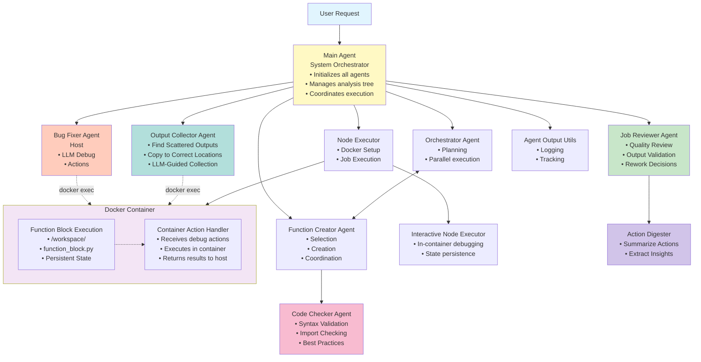
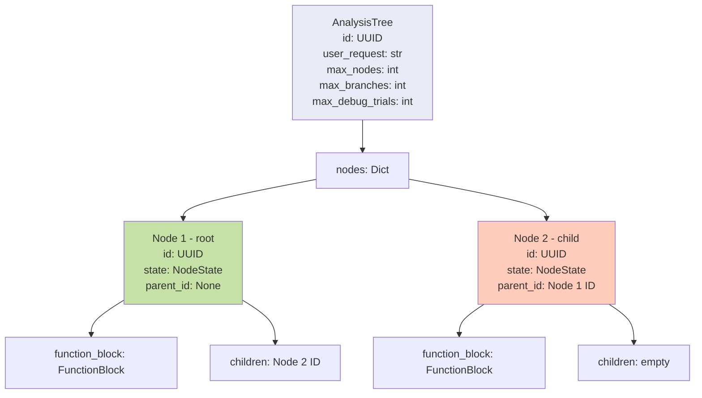
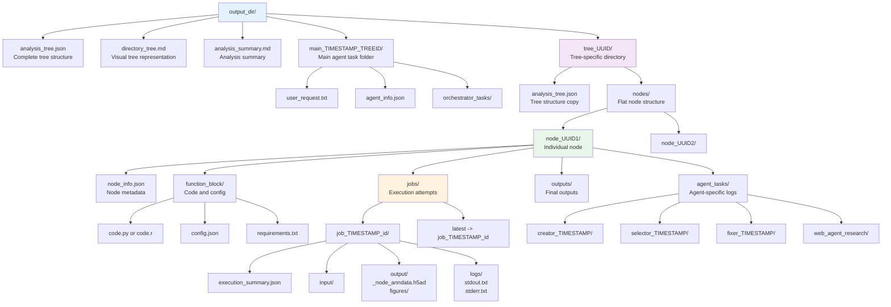

# OmiCairn Agent Architecture Documentation

## Overview

The OmiCairn Local Agent system employs a sophisticated multi-agent architecture designed for automated single-cell RNA sequencing analysis. The system orchestrates complex bioinformatics workflows through a hierarchical analysis tree structure, where each node represents an independent analysis step that can be executed in isolation or in parallel with other nodes.

## Table of Contents

1. [System Architecture](#system-architecture)
2. [Agent Descriptions](#agent-descriptions)
3. [Input/Output Specifications](#inputoutput-specifications)
4. [Analysis Tree Integration](#analysis-tree-integration)
5. [Agent Communication](#agent-communication)
6. [Error Handling and Recovery](#error-handling-and-recovery)
7. [Directory Structure](#directory-structure)

## System Architecture



## Agent Descriptions

### 1. Main Agent (`agents/main_agent.py`)

**Purpose**: Primary system orchestrator that coordinates all other agents and manages the overall analysis workflow.

**Key Responsibilities**:
- Initialize and coordinate all specialized agents
- Create and manage the analysis tree structure
- Execute nodes through the NodeExecutor
- Handle node failures through bug fixing
- Implement iterative tree expansion with safeguards
- Manage output directory structure and logging

**Key Methods**:
- `run_analysis()`: Main entry point for analysis (replaced `analyze()`)
- `_generate_and_execute_plan()`: Iterative tree expansion and execution
- `_execute_tree()`: Execute the analysis tree
- `_execute_single_node()`: Execute individual nodes
- `_attempt_fix()`: Coordinate bug fixing for failed nodes
- `_log_function_creation_to_node()`: Log agent activities
- `_create_analysis_summary_md()`: Create analysis summary markdown

### 2. Orchestrator Agent (`agents/orchestrator_agent.py`)

**Purpose**: Strategic planning and workflow orchestration with automatic rework handling and parallel execution capabilities.

**Key Responsibilities**:
- **Automatic rework handling** for nodes that fail job review (NEW)
- Plan analysis workflows based on user requests
- Manage parallel execution of independent nodes
- Make tree expansion decisions
- Coordinate between function selection and execution
- Handle reactive tree expansion based on completion
- **Enforce satisfaction criteria** - root node doesn't satisfy analysis requests (NEW)

**Automatic Rework System** (NEW):
- When nodes have `needs_rework=True`, orchestrator automatically creates rework actions
- **No LLM consultation** for rework decisions - purely system-driven
- Sets `propagate_failure_context_from` automatically for proper tracking
- Returns rework actions immediately without calling LLM
- Only consults LLM when no automatic rework is needed

**Key Methods**:
- `plan_next_steps()`: Check for automatic rework first, then LLM planning if needed
- `process()`: Main orchestration method (legacy)
- `_plan_with_llm()`: LLM-based planning with structured output (only called after rework check)
- `_needs_expansion()`: Check if tree needs expansion
- `_expand_tree()`: Expand tree with new nodes
- `_build_planning_prompt()`: Build prompt for LLM planner with satisfaction criteria

**Satisfaction Criteria**:
- Root node (`load_input_data`) does NOT count as satisfying analysis requests
- Only nodes performing actual analysis/computation count
- Never marks request satisfied with only root node unless "load data" was the only request

### 3. Function Creator Agent (`agents/function_creator_agent.py`)

**Purpose**: Select existing function blocks or generate new ones for specific analysis tasks.

**Key Responsibilities**:
- Analyze analysis progress and recommend appropriate function blocks
- Select from existing function blocks when suitable
- Generate new Python/R code using LLM when needed
- Implement standardized function block framework
- Create comprehensive error handling
- Generate requirements and configuration
- Specialize in single-cell analysis patterns

**Key Methods**:
- `process_selection_or_creation()`: Unified method to select/create function blocks
- `create_function()`: Generate new function block
- `_build_creation_prompt()`: Construct LLM prompt
- `_parse_llm_response()`: Parse generated code
- `_validate_function_block()`: Validate generated code
- `_extract_code_and_config()`: Extract code and configuration from LLM response
- `_enhance_prompt_with_examples()`: Add relevant examples to prompt

**Function Block Signature**:
```python
def run(path_dict, params):
    """
    Standard function block interface.
    
    Args:
        path_dict: Dictionary with 'input_dir' and 'output_dir' paths
        params: Dictionary of analysis parameters
    
    Returns:
        Processed data object
    """
```

### 4. Bug Fixer Agent (Unified Implementation)

**Purpose**: Automatically debug and fix failed function blocks using pure action-based approach.

**Architecture**: 
- **Host Execution**: Bug fixer runs on host system for LLM interaction
- **Container Actions**: All debugging actions execute inside the Docker container via `docker exec`
- **State Persistence**: Container remains alive between debug attempts

**Key Components**:
1. **UnifiedBugFixer** (`agents/unified_bug_fixer/unified_bug_fixer.py`): Main bug fixing orchestrator
2. **DebugSession** (`agents/unified_bug_fixer/debug_session.py`): Manages multi-turn debugging conversation with LLM
3. **EnhancedDebugSession** (`agents/unified_bug_fixer/enhanced_debug_session.py`): Enhanced version with error propagation and JSON mode
4. **EnhancedDebugSessionV2** (`agents/unified_bug_fixer/enhanced_debug_session_v2.py`): Latest version with improved features
5. **ContainerActionHandler**: Executes actions inside container (replaces ActionExecutor)
6. **InContainerDebugSession**: Bridge between host bug fixer and container execution
7. **WebAgentTool** (`agents/web_agent_langgraph/web_agent_tool.py`): Optional web research capability

**Action-Based Debugging**:
- NO hardcoded pattern matching or preset solutions
- All fixes determined by LLM analysis
- Available actions:
  - `read_file`: Read file contents (text files only)
  - `write_file`: Modify code files
  - `execute_command`: Run simple shell commands (ls, pwd, pip list, etc.)
  - `write_and_run`: Write multiple files and execute a script (preferred for Python code)
  - `update_function_block`: Update code with immediate re-execution
  - `install_package`: Install missing dependencies
  - `list_directory`, `check_file_exists`, `head_file`, `tail_file`, `grep_file`
  - `get_data_info`: Get information about the current data state
  - `explore_attributes`: Explore object attributes and methods
  - `list_previous_nodes`, `retrieve_previous_node_file`: Access outputs from earlier nodes

**Execution Flow**:
1. Function block fails in container
2. Container stays alive for debugging
3. Bug fixer analyzes error on host
4. LLM determines debugging actions
5. Actions execute in container via docker exec
6. Results returned to bug fixer
7. Process repeats until fixed or max turns reached

**Key Features**:
- **Auto Re-execution**: `update_function_block` immediately re-runs code
- **Web Research**: Can search online for error solutions
- **Multi-turn Sessions**: Default 5 turns of iterative debugging
- **Clean Architecture**: No monkey-patching, direct session creation

**write_and_run Action** (Recommended for Python code):
- **Purpose**: Write multiple files and execute a script in one atomic operation
- **Advantages over execute_command**:
  - Avoids Python one-liner syntax issues
  - Allows proper multi-line code with correct indentation
  - Provides better error messages and debugging
  - Scripts are saved for review and re-execution
- **Usage Pattern**:
  ```python
  {
    "type": "write_and_run",
    "params": {
      "files": [
        {"path": "explore.py", "content": "import scanpy as sc\n..."},
        {"path": "config.json", "content": "{}"}
      ],
      "run_script": "python explore.py"
    }
  }
  ```
- **Output Display**: Shows stdout, stderr, exit code, and files created in turn summaries

### 5. Job Reviewer Agent (`agents/job_reviewer_agent.py`)

**Purpose**: Automated quality assurance for executed function blocks with automatic rework triggering.

**Key Responsibilities**:
- Review function block outputs after execution
- Validate that outputs match claimed functionality
- Check for potential issues (placeholder or fabricated outputs in generated code, incomplete implementation)
- **Trigger automatic rework** when quality standards not met (NEW)
- Work with Action Digester for comprehensive analysis
- **Skip review for system-generated root node** (NEW)

**Rework Integration** (NEW):
- When critical issues found, node's `needs_rework` flag is set by MainAgent
- MainAgent checks rework limits immediately after review
- If under limit: `needs_rework=True` triggers automatic orchestrator rework
- If at limit: `rework_limit_reached=True` prevents further rework
- Root node (`load_input_data`) is automatically skipped from review

**Key Methods**:
- `review_function_block()`: Main review method
- `_build_review_prompt()`: Construct review prompt with context
- `_parse_review_response()`: Parse LLM review response
- `_categorize_concerns()`: Categorize review concerns by severity

**Review Criteria**:
- Output validation (do outputs exist as claimed?)
- Implementation completeness (no placeholder or fabricated outputs in generated code)
- Error handling quality
- Documentation accuracy
- Performance considerations

**Status Separation**:
- Execution status (`node.state`): Whether code ran successfully
- Job review status (`node.job_review_status`): Quality assessment result
- A node can be execution=COMPLETED but review=FAILED

### 6. Code Checker Agent (`agents/code_checker_agent.py`)

**Purpose**: Pre-execution validation of function block code.

**Key Responsibilities**:
- Validate Python/R syntax before execution
- Check for missing imports
- Identify common coding errors
- Suggest fixes for issues
- Integrate with Function Creator for immediate feedback

**Key Methods**:
- `check_code()`: Main validation method
- `_validate_python_code()`: Python-specific validation
- `_check_imports()`: Verify all imports are present
- `_suggest_fixes()`: Generate fix suggestions

**Integration**:
- Called by Function Creator after code generation
- Provides feedback loop for code improvement
- Reduces execution failures from syntax errors

### 7. Action Digester Agent (`agents/action_digester.py`)

**Purpose**: Summarize and extract insights from bug fixer actions.

**Key Responsibilities**:
- Process bug fixer action sequences
- Extract key insights and patterns
- Generate concise summaries for Job Reviewer
- Identify successful fix strategies

**Key Methods**:
- `digest_actions()`: Process action list
- `extract_key_insights()`: Identify important patterns
- `generate_summary()`: Create concise summary

### 8. Output Collector Agent (`agents/output_collector/`)

**Purpose**: Collect outputs saved to unexpected locations after function execution.

**Key Responsibilities**:
- Detect scattered outputs in container filesystem
- Copy files to correct output directory structure
- Handle package-specific behaviors (e.g., scanpy saves to ./figures/)
- Use LLM-guided multi-turn approach for intelligent collection
- Preserve directory structure when copying

**Key Methods**:
- `collect_outputs()`: Main collection orchestration
- `_build_collection_prompt()`: Create LLM prompt with context
- `_get_current_state()`: Analyze current filesystem state
- `_parse_actions()`: Parse LLM-suggested actions
- `_generate_summary()`: Create collection report

**Architecture**:
- Shares container action system with Bug Fixer
- Runs after successful execution, before job review
- Uses domain knowledge for package-specific behaviors
- Logs all activities to agent_tasks/output_collector/

### 9. Agent Output Utils (`agents/agent_output_utils.py`)

**Purpose**: Centralized logging and output management for all agents.

**Key Responsibilities**:
- Log LLM interactions
- Track bug fix attempts
- Record function selections
- Create structured outputs
- Generate task summaries

**Key Functions**:
- `log_agent_task()`: Log agent activities
- `log_bug_fix_attempt()`: Track debugging attempts
- `log_function_selection()`: Record selection process
- `get_task_summary()`: Generate activity summaries

## Input/Output Specifications

### Main Agent

**Inputs**:
```python
{
    "input_data_path": Union[str, Path],  # Path to input data (H5AD/RDS)
    "user_request": str,                  # Natural language analysis request
    "output_dir": Optional[Union[str, Path]],  # Output directory path
    "max_nodes": int,                     # Maximum number of analysis nodes
    "max_children": int,                  # Maximum children per node
    "max_debug_trials": int,              # Maximum debug attempts per node
    "max_iterations": int,                # Maximum planning iterations (safeguard)
    "generation_mode": str,               # "mixed", "only_new", "only_existing"
    "llm_model": str,                     # OpenAI model to use
    "verbose": bool,                      # Enable verbose logging
    # Claude-specific parameters
    "max_claude_turns": Optional[int],    # Maximum Claude debugging turns
    "max_claude_cost": Optional[float],   # Maximum Claude API cost
    "max_claude_tokens": Optional[int]    # Maximum Claude tokens
}
```

**Outputs**:
```python
{
    "tree_id": str,                 # Unique tree identifier
    "output_dir": str,              # Output directory path
    "tree_file": str,               # Analysis tree JSON path
    "total_nodes": int,             # Total nodes created
    "completed_nodes": int,         # Successfully executed nodes
    "failed_nodes": int,            # Failed nodes
    "pending_nodes": int,           # Pending nodes
    "results": Dict[str, Any],      # Node execution results
    "timing_summary": Dict[str, Any],  # Timing statistics
    "tree_structure": {             # Tree structure details
        "nodes": Dict[str, NodeInfo],
        "root_nodes": List[str]
    },
    "claude_usage": {               # Optional Claude usage stats
        "total_cost": float,
        "total_tokens": int,
        "model": str,
        "sessions": int,
        "success_rate": float
    }
}
```

### Orchestrator Agent

**Inputs**:
```python
{
    "user_request": str,            # Analysis request
    "tree_state": Dict,             # Current tree state
    "iteration": int,               # Current iteration
    "parent_node": Dict,            # Parent node info (if expanding)
    "phase": str                    # "root" or "expansion"
}
```

**Outputs**:
```python
{
    "satisfied": bool,              # User request satisfied
    "recommendations": List[Dict],  # Recommended function blocks
    "reasoning": str,               # Decision reasoning
    "parallel_groups": List[List]   # Nodes for parallel execution
}
```

**Multi-Method Request Handling**:
The orchestrator includes special logic for handling requests with multiple numbered tasks:

- **Task Counting**: Explicitly counts numbered items in user requests
- **Satisfaction Tracking**: Only marks `satisfied=true` after ALL requested methods attempted
- **Progress Monitoring**: Tracks completion like "User requested 9 methods, created 5, need 4 more"
- **Failure Tolerance**: Failed nodes don't prevent creation of sibling methods
- **One-at-a-Time Creation**: Returns only ONE next_action per response for proper tree structure

Example: For "Run 5 pseudotime methods", orchestrator ensures all 5 methods are attempted before marking satisfied.

### Function Creator Agent

**Inputs**:
```python
{
    "task_description": str,        # Task to implement
    "user_request": str,            # Original request
    "parent_output": Dict,          # Parent node output info
    "data_summary": Dict,           # Current data state
    "language": str                 # "python" or "r"
}
```

**Outputs**:
```python
NewFunctionBlock(
    name: str,                      # Function block name
    type: FunctionBlockType,        # PYTHON or R
    description: str,               # Block description
    code: str,                      # Generated code
    requirements: str,              # Package requirements
    parameters: Dict[str, Any],     # Default parameters
    static_config: StaticConfig     # Configuration
)
```

### Bug Fixer Agent

**Inputs**:
```python
{
    "node_name": str,               # Failed node name
    "error_message": str,           # Error message
    "working_directory": Path,      # Working directory path
    "code": str,                    # Function block code
    "requirements": List[str],      # Package requirements
    "language": str,                # "python" or "r"
    "stdout": str,                  # Standard output
    "stderr": str,                  # Standard error
    "context": Dict[str, Any],      # Additional context
    "action_handler": Optional[Any] # Action handler for container execution
}
```

**Outputs**:
```python
{
    "success": bool,                # Fix successful
    "fixed_code": str,              # Fixed code
    "fixed_requirements": List[str],# Updated requirements
    "fix_description": str,         # What was fixed
    "attempts": int,                # Number of attempts
    "total_cost": float,            # Total cost of LLM calls
    "total_tokens": int,            # Total tokens used
    "session_history": List[Dict],  # Debug session history
    "error": Optional[str]          # Error if failed
}
```

## Analysis Tree Integration

### Tree Structure



### Node States

- **PENDING**: Node created but not executed
- **RUNNING**: Currently executing
- **COMPLETED**: Successfully executed
- **FAILED**: Execution failed
- **DEBUGGING**: Being fixed by Bug Fixer

### Tree Expansion Strategy

1. **Root Creation**: Main Agent creates root node based on initial request
2. **Execution**: Nodes execute in dependency order
3. **Expansion Decision**: Orchestrator decides if expansion needed
4. **Child Creation**: Function Creator generates children
5. **Iterative Process**: Repeat until satisfied or limits reached

## Agent Communication

### Communication Patterns

1. **Direct Method Calls**: Agents call each other's methods directly
2. **Shared Data Structures**: Analysis tree shared between agents
3. **Event Callbacks**: Completion callbacks for reactive expansion
4. **Logging Framework**: Centralized activity tracking

### Data Exchange Format

```python
# Standard context dictionary
context = {
    "user_request": str,
    "tree": AnalysisTree,
    "current_node": AnalysisNode,
    "data_summary": Dict,
    "execution_state": Dict,
    "agent_logs": List[Dict]
}
```

## Error Handling and Recovery

### Error Detection

1. **Execution Monitoring**: Track node execution status
2. **Output Validation**: Verify expected outputs exist
3. **Log Analysis**: Parse stdout/stderr for errors
4. **Timeout Detection**: Handle long-running nodes

### Recovery Strategies

1. **LLM-Based Debugging**: Primary approach
   - Send error context to LLM
   - LLM analyzes error and determines actions
   - Execute actions in container environment
   - Iterate until fixed or max turns reached

2. **Web Research Integration**: Optional enhancement
   - Search for error solutions online
   - Use LangGraph web agent for deep research
   - Incorporate findings into debugging session

3. **Retry Logic**:
   - Maximum attempts per node (configurable, default 3)
   - Maximum turns per debug session (configurable, default 5)
   - Persistent container state between attempts
   - Automatic cleanup after max attempts

### Fallback Mechanism

When LLM services are unavailable, MainAgent handles gracefully:

1. **Automatic Detection**: If no LLM service is configured
2. **Error Reporting**: Clear error message that LLM service is required
3. **Graceful Exit**: No default pipeline - requires LLM for operation
4. **Configuration Help**: Suggests how to configure API keys

## Directory Structure

### Output Organization



### Log Files

**Agent Activity Logs** (`agent_tasks/`):
- LLM prompts and responses
- Function selection reasoning
- Bug fix attempts and versions
- Task summaries and statistics

**Execution Logs** (`jobs/`):
- stdout.txt: Standard output
- stderr.txt: Standard error
- job_metrics.csv: Performance metrics
- job_info.json: Execution metadata

## Best Practices

### Agent Development

1. **Clear Interfaces**: Define explicit input/output contracts
2. **Error Handling**: Comprehensive try-catch blocks
3. **Logging**: Detailed activity logging for debugging
4. **Validation**: Validate inputs and outputs
5. **Documentation**: Clear docstrings and comments

### System Configuration

1. **Timeout Settings**: Configure appropriate timeouts
2. **Retry Limits**: Set reasonable retry attempts
3. **Resource Limits**: Control parallel execution
4. **Model Selection**: Choose appropriate LLM models
5. **Logging Levels**: Configure verbosity as needed

### Performance Optimization

1. **Parallel Execution**: Leverage job pools for independent nodes
2. **Caching**: Cache LLM responses when possible
3. **Resource Management**: Clean up temporary files
4. **Batch Operations**: Group related operations
5. **Early Termination**: Stop on satisfaction

## Future Enhancements

### Planned Features

1. **Agent Specialization**: Domain-specific agents
2. **Learning System**: Learn from successful patterns
3. **Distributed Execution**: Multi-machine support
4. **Interactive Mode**: User intervention points
5. **Visualization**: Real-time execution monitoring

### Extension Points

1. **Custom Agents**: Add specialized analysis agents
2. **New Languages**: Support additional languages
3. **External Tools**: Integrate third-party tools
4. **Cloud Services**: Add cloud execution backends
5. **API Integration**: REST API for remote access