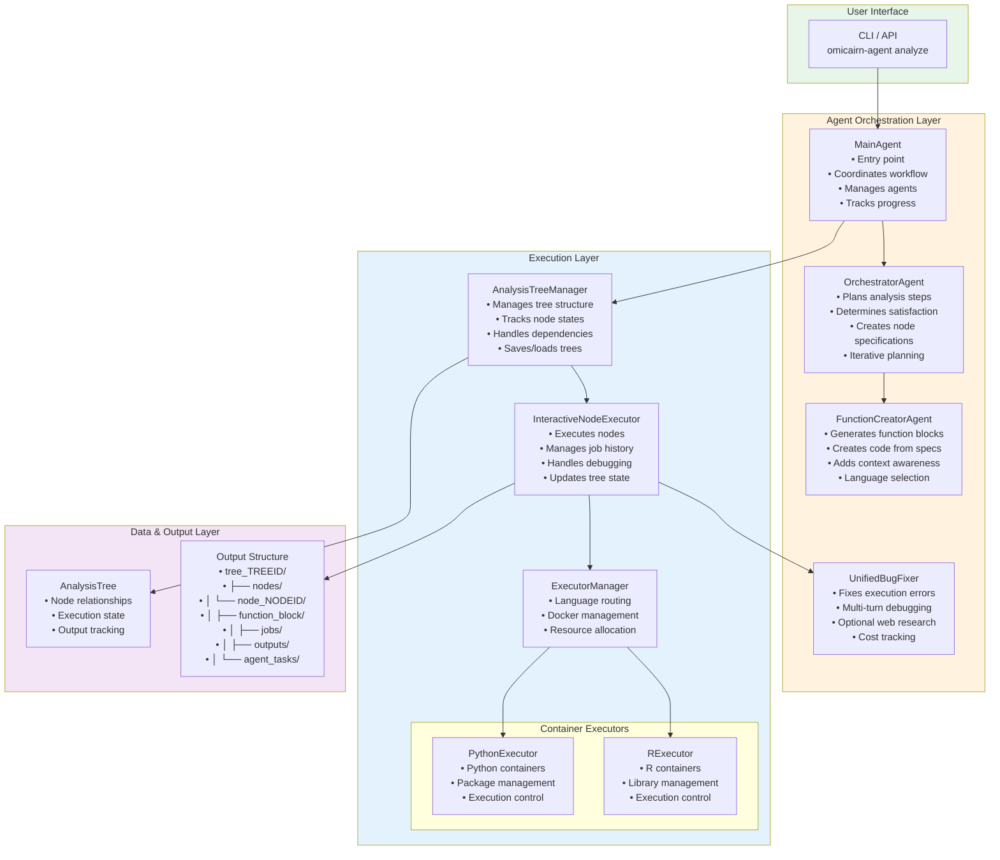
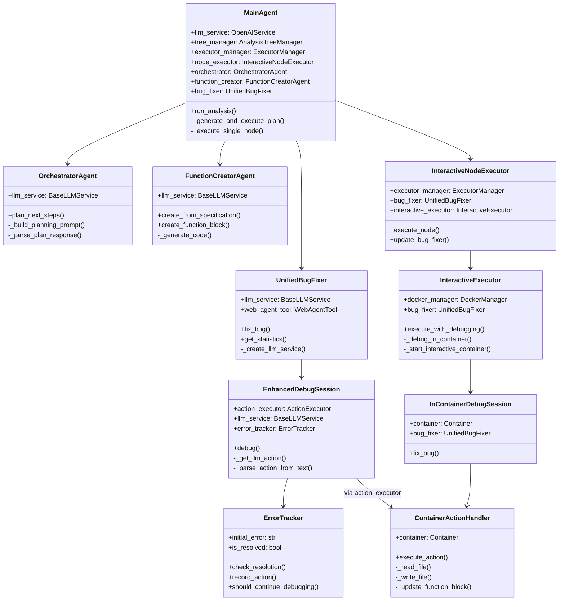

# Bug Fixer Container Architecture

## Overview

The bug fixer system uses a sophisticated architecture where the bug fixer runs on the host system while all debugging actions execute inside the Docker container where the error occurred. This design ensures proper isolation while maintaining access to the actual execution environment.

### Integration with Data Loading Root Node

With the new data loading root node architecture:
- **Resilient Foundation**: Trees always start with a successful data loading node
- **Continued Expansion**: Even if computation nodes fail, the tree can grow with alternative approaches
- **Better Recovery**: Bug fixer can work on failed nodes while orchestrator plans new branches
- **No Tree Blockage**: Root node failure no longer prevents the entire analysis from proceeding

## Architecture Diagrams

### Bug Fixer Container Architecture

```mermaid
graph TB
    subgraph HostSystem[Host System]
        subgraph MainAgentBlock[Main Agent]
            InteractiveExecutor[InteractiveExecutor<br/>• Starts Docker container<br/>• Executes function block<br/>• Detects failure<br/>• Keeps container alive]
            
            InContainerDebugSession[InContainerDebugSession<br/>• Creates ContainerActionHandler<br/>• Creates EnhancedDebugSession<br/>• Manages bug fixing in container context]
            
            EnhancedDebugSession[EnhancedDebugSession<br/>• Manages debugging turns<br/>• Tracks error resolution<br/>• Saves debug logs<br/>• Early termination on success]
            
            UnifiedBugFixer[UnifiedBugFixer<br/>• Analyzes errors with LLM<br/>• Optional web research<br/>• Manages session creation<br/>• Tracks costs and statistics]
            
            ErrorTracker[ErrorTracker<br/>• Monitors error resolution<br/>• Tracks action results<br/>• Determines when to stop<br/>• Records session history]
            
            InteractiveExecutor --> InContainerDebugSession
            InContainerDebugSession --> UnifiedBugFixer
            UnifiedBugFixer --> EnhancedDebugSession
            EnhancedDebugSession --> ErrorTracker
        end
    end
    
    subgraph DockerContainer[Docker Container]
        ContainerActionHandler[ContainerActionHandler<br/>• Receives actions from bug fixer<br/>• Executes via docker exec<br/>• Returns results to host<br/><br/>Actions:<br/>- read_file: Read file contents<br/>- write_file: Modify code files<br/>- execute_command: Run shell commands<br/>- update_function_block: Update code + re-execute<br/>- install_package: Install dependencies<br/>- list_directory, check_file_exists, etc.]
        
        Workspace[/workspace/<br/>• function_block.py<br/>• requirements.txt<br/>• input/<br/>• output/<br/>• Persistent state between debug attempts]
        
        ContainerActionHandler --> Workspace
    end
    
    EnhancedDebugSession -.->|docker exec| ContainerActionHandler
    
    style HostSystem fill:#e8f5e9
    style DockerContainer fill:#e3f2fd
    style UnifiedBugFixer fill:#fff3e0
    style ContainerActionHandler fill:#fce4ec
```

### Complete System Workflow



### Class and File Relationships



## Key Components

### 1. InteractiveExecutor (`job_executors/interactive_executor.py`)

Manages Docker container lifecycle and debugging:
- Starts container with function block in interactive mode
- Detects execution failures
- Keeps container alive for debugging
- Initiates bug fixing via InContainerDebugSession
- Supports multiple debug attempts (max_debug_attempts)
- Collects results after successful fix
- Performs pre-flight validation if specifications exist

### 2. InContainerDebugSession (`job_executors/interactive_executor.py`)

Bridge between host bug fixer and container execution:
- Creates ContainerActionHandler with container reference
- Creates EnhancedDebugSession from unified bug fixer
- Manages the debugging lifecycle with proper container context
- Temporarily disables web agent for in-container execution
- Adds container metadata to results
- No monkey-patching - clean architecture with proper dependency injection

### 3. ContainerActionHandler (`job_executors/interactive_executor.py`)

Executes all debugging actions inside the container:
- Translates action requests to docker exec commands
- Handles file I/O, command execution, package installation
- Enhanced `update_function_block` with automatic re-execution
- Maintains reference to InteractiveExecutor for re-execution capability
- Returns structured results to bug fixer
- **Field Validation**: Validates all required fields before execution
- Supports all standard debugging actions:
  - `list_directory`, `check_file_exists`, `read_file`, `write_file`
  - `execute_command`, `install_package`, `update_function_block`
  - `head_file`, `tail_file`, `grep_file`
  - `get_data_info`, `explore_attributes`

### 4. UnifiedBugFixer (Host) (`agents/unified_bug_fixer/unified_bug_fixer.py`)

Orchestrates the debugging process:
- Analyzes errors using LLM (supports GPT-4, Claude, and other models)
- Determines appropriate debugging actions
- **Uses text parsing for actions** (OpenAI's strict JSON mode incompatible with flexible action schema)
- Manages multi-turn conversation (default 5 turns)
- Tracks session history and costs
- Optionally uses web research via WebAgentTool
- Creates EnhancedDebugSession for actual debugging execution

### 5. EnhancedDebugSession (`agents/unified_bug_fixer/enhanced_debug_session.py`)

Manages the actual debugging conversation:
- Conducts multi-turn debugging sessions with LLM
- Uses ErrorTracker for early termination on success
- Parses actions from text responses (JSON blocks in markdown)
- Validates and executes actions via ActionExecutor
- Saves detailed turn logs and session history
- Tracks files modified and actions taken

### 6. ErrorTracker (`agents/unified_bug_fixer/error_tracker.py`)

Monitors error resolution:
- Tracks initial error and current state
- Analyzes action results for resolution signals
- Checks for successful execution (exit_code == 0)
- Verifies output file creation
- Enables early termination when error is fixed
- Maintains comprehensive session history

## Execution Flow

### 1. Normal Execution
```
1. InteractiveNodeExecutor receives node to execute
2. InteractiveExecutor starts Docker container in interactive mode
3. Pre-flight validation performed (if specifications exist)
4. Function block executes inside container
5. Success: Results collected and container stopped
6. Failure: Continue to debugging flow
```

### 2. Debugging Flow
```
1. Container stays alive after failure
2. InContainerDebugSession created
3. ContainerActionHandler instantiated
4. Bug fixer analyzes error on host
5. LLM suggests debugging actions
6. Actions execute in container via docker exec
7. Results returned to bug fixer
8. Process repeats until fixed (max 5 turns)
9. Container stopped after debugging complete
```

### 3. Action Execution Example

When bug fixer requests `update_function_block`:

```python
# 1. Bug fixer sends action in text response with JSON block
LLM Response:
"""
I'll fix the import error by updating the function block with the required packages.

```json
{
    "type": "update_function_block",
    "params": {
        "code": "def run(path_dict, params): ...",
        "requirements": ["pandas", "scanpy"],
        "language": "python"
    },
    "explanation": "Fixing import error by adding required packages",
    "confidence": 0.85
}
```
"""

# 2. EnhancedDebugSession parses and extracts action
action = {
    "type": "update_function_block",
    "code": "def run(path_dict, params): ...",
    "requirements": ["pandas", "scanpy"],
    "language": "python"
}

# 3. ActionExecutor validates fields
- Checks required field 'code' is present and non-empty
- Validates language is 'python' or 'r' (if provided)
- Returns error if validation fails

# 4. ContainerActionHandler processes
- Writes code to /workspace/function_block.py or function_block.r
- Updates /workspace/requirements.txt
- Validates syntax (Python or R)
- Installs new requirements if needed
- Automatically re-executes the code
- Returns execution results

# 5. Result returned to bug fixer
{
    "success": True,
    "syntax_valid": True,
    "requirements_installed": True,
    "re_execution": {
        "attempted": True,
        "success": True,
        "stdout": "...",
        "stderr": "",
        "output_exists": True,
        "exit_code": 0
    }
}
```

## Benefits

### 1. Isolation
- Bug fixer runs on host with full system access
- Actions execute in isolated container environment
- No risk of damaging host system

### 2. State Persistence
- Container remains alive between debug attempts
- Installed packages persist
- File modifications accumulate
- Faster iteration cycles

### 3. Accurate Debugging
- Actions execute in the exact environment where error occurred
- Access to actual data files
- Same package versions and configurations

### 4. Clean Architecture
- No monkey-patching
- Clear separation of concerns
- Easy to test and maintain
- Extensible for new actions

## Configuration

### Enable Container Debugging
```python
agent = MainAgent(
    bug_fixer_type="unified",
    bug_fixer_model="gpt-4",  # or "claude-3-5-sonnet-20241022"
    enable_interactive_debug=True,  # Default: True
    enable_web_search=False,  # Enable web search in bug fixer
    enable_web_agent=True  # Enable LangGraph web agent for research
)
```

### Container Settings
- Memory limit: Configurable via config
- CPU limit: Configurable via config
- Timeout: 30 seconds per action (configurable)
- Max debug attempts: 3 (configurable via max_debug_attempts)
- Max debug turns per session: 5 (configurable via max_turns)
- Web agent timeout: 90 seconds (configurable via WEB_AGENT_TIMEOUT env var)

## Future Enhancements

### 1. Reviewer Agent (Planned)
- Analyze function block outputs for correctness
- Provide semantic feedback beyond syntax/runtime errors
- Feed review results back to bug fixer

### 2. Enhanced Actions
- Snapshot/restore container state
- Interactive debugging sessions
- Performance profiling actions

### 3. Learning System
- Cache successful fixes
- Pattern recognition for common errors
- Suggest fixes based on history

## File Structure

```
agents/
├── main_agent.py                    # Entry point, coordinates workflow
├── orchestrator_agent.py            # Plans analysis steps
├── function_creator_agent.py        # Generates function blocks
└── unified_bug_fixer/
    ├── unified_bug_fixer.py         # Main bug fixer class
    ├── enhanced_debug_session.py    # Debugging session management
    ├── error_tracker.py             # Error resolution tracking
    └── action_executor.py           # Action validation and routing

job_executors/
├── executor_manager.py              # Routes to language executors
├── interactive_executor.py          # Container lifecycle & debugging
│   ├── InteractiveExecutor          # Main execution class
│   ├── InContainerDebugSession      # Debug session bridge
│   └── ContainerActionHandler       # Container action execution
├── python_executor.py               # Python-specific execution
└── r_executor.py                    # R-specific execution

analysis_tree_management/
├── tree_manager.py                  # Tree structure management
├── interactive_node_executor.py     # Node execution with debugging
└── node_executor.py                 # Standard node execution
```

## Troubleshooting

### Common Issues

1. **Container Communication Failure**
   - Check Docker daemon is running
   - Verify container is still alive
   - Check docker exec permissions

2. **Action Parsing Failure**
   - Bug fixer uses text parsing (not JSON mode)
   - Expects JSON blocks in markdown code fences
   - Check LLM response format

3. **Action Timeout**
   - Default 30s timeout per action
   - Increase for long-running operations
   - Check for infinite loops

4. **State Corruption**
   - Container automatically cleaned up after max attempts
   - Fresh container for each node execution
   - No cross-node contamination

### Debug Logging

Enable verbose logging:
```python
import logging
logging.getLogger("omicairn_agent_local").setLevel(logging.DEBUG)
```

Logs show:
- LLM inputs and outputs
- Action parsing details
- Container command output
- Error tracking state
- Performance metrics

### Debug Output Files

Each debug session creates:
```
node_NODEID/agent_tasks/bug_fixer/
├── attempt_1/
│   ├── turn_1_TIMESTAMP.md       # Human-readable turn log
│   ├── turn_1_TIMESTAMP.json     # Machine-readable turn data
│   └── ...
├── error_tracking_summary.json   # Session summary
└── debug_progress.txt            # Real-time progress