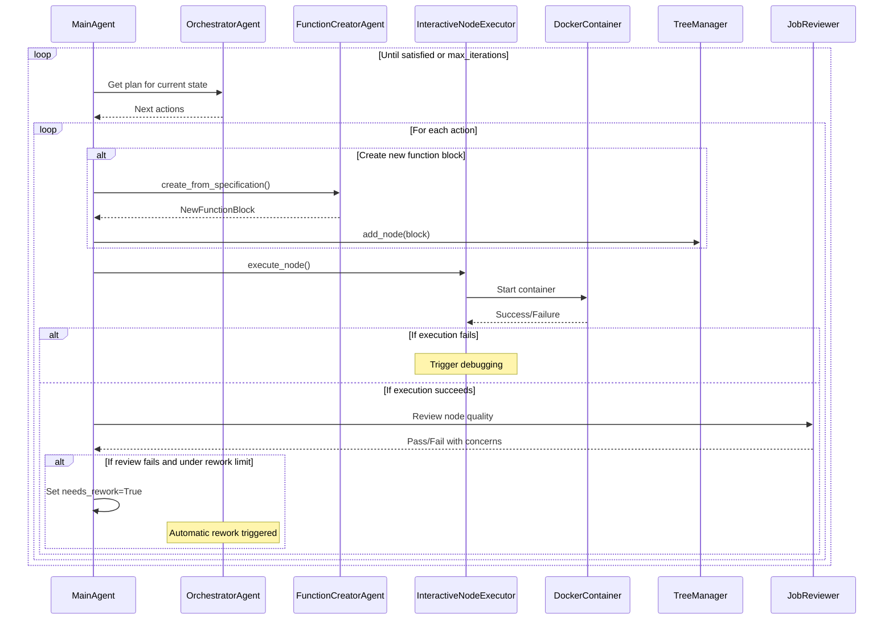
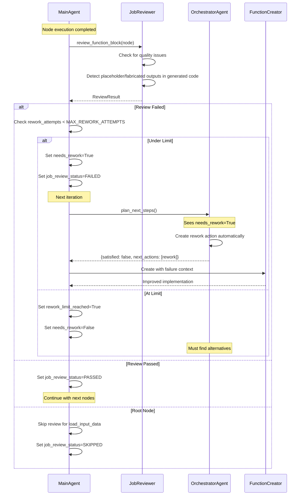
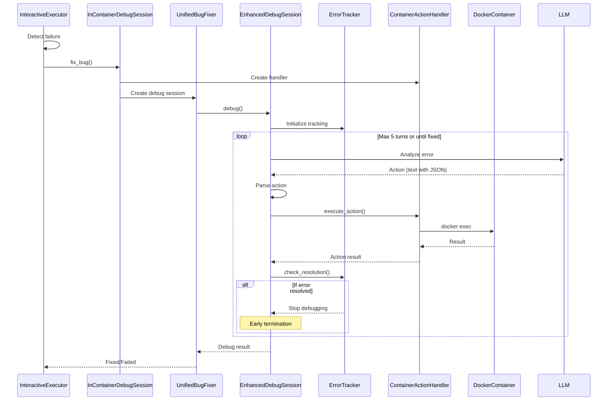

# Complete System Workflow Documentation

## Overview

This document provides a comprehensive view of how the OmiCairn Agent Local system works, from user request to final output, including all agent interactions and the bug fixing workflow.

## System Components Overview

### 1. **User Interface Layer**
- CLI command: `omicairn-agent analyze`
- Python API: `MainAgent.run_analysis()`
- Input: Data file + natural language request
- Output: Analysis tree with results

### 2. **Agent Orchestration Layer**
- **MainAgent**: Entry point and coordinator
- **OrchestratorAgent**: Plans analysis steps
- **FunctionCreatorAgent**: Generates code blocks
- **UnifiedBugFixer**: Fixes execution errors

### 3. **Execution Layer**
- **AnalysisTreeManager**: Manages tree structure
- **InteractiveNodeExecutor**: Executes nodes with debugging
- **ExecutorManager**: Routes to language-specific executors
- **Docker Containers**: Isolated execution environments

### 4. **Data Layer**
- **AnalysisTree**: Node relationships and state
- **Output Structure**: Organized file hierarchy
- **Function Blocks**: Reusable code components

## Detailed Workflow

### Phase 1: Request Processing

```mermaid
sequenceDiagram
    participant User
    participant MainAgent
    participant TreeManager
    participant InteractiveNodeExecutor
    participant OrchestratorAgent
    
    User->>MainAgent: run_analysis(data, request)
    MainAgent->>TreeManager: create_tree(request)
    TreeManager->>TreeManager: _create_data_loading_block()
    TreeManager->>TreeManager: add_root_node(data_loading_block)
    TreeManager-->>MainAgent: AnalysisTree with data loading root
    MainAgent->>MainAgent: Create output directory
    MainAgent->>InteractiveNodeExecutor: Execute data loading root node
    InteractiveNodeExecutor-->>MainAgent: Root node completed
    MainAgent->>MainAgent: Skip job review for root node
    MainAgent->>OrchestratorAgent: plan_next_steps(tree_state)
    Note over OrchestratorAgent: Check for needs_rework nodes first
    alt Has nodes with needs_rework=True
        OrchestratorAgent->>OrchestratorAgent: Create automatic rework actions
        OrchestratorAgent-->>MainAgent: {satisfied: false, actions: [rework]}
    else No rework needed
        OrchestratorAgent->>LLM: Consult for planning
        Note over OrchestratorAgent: Root node alone NEVER satisfies request
        OrchestratorAgent-->>MainAgent: {satisfied: false, actions: [...]}
```

### Phase 2: Iterative Planning and Execution



### Phase 3: Job Review and Automatic Rework



### Phase 4: Bug Fixing Workflow



## Key Workflows

### 1. Function Block Creation

```python
# OrchestratorAgent creates specification
spec = {
    "name": "perform_clustering",
    "task": "Cluster cells using Leiden algorithm",
    "is_root": False,
    "language": "python"
}

# FunctionCreatorAgent generates code
block = FunctionCreatorAgent.create_from_specification(spec, context)
# Returns NewFunctionBlock with:
# - code: Complete Python/R implementation
# - requirements: Package dependencies
# - description: What the block does
# - output_description: What it produces
```

### 2. Node Execution

```python
# InteractiveNodeExecutor executes with debugging
result = executor.execute_node(
    node=node,
    tree=tree,
    input_path=parent_output_path,
    output_base_dir=output_dir,
    max_debug_attempts=3
)
```

### 3. Bug Fixing Actions

The bug fixer uses these actions to debug inside containers:

| Action | Purpose | Example |
|--------|---------|---------|
| `read_file` | Read code or data files | Read function_block.py to understand error |
| `write_file` | Modify files | Update code with fixes |
| `execute_command` | Run shell commands | Check package versions, test imports |
| `install_package` | Install dependencies | Add missing packages |
| `update_function_block` | Update code + re-execute | Apply complete fix and test |
| `list_directory` | Explore structure | Find available files |
| `check_file_exists` | Verify files | Check if output was created |

### 4. Error Resolution Flow

```python
# ErrorTracker monitors resolution
tracker = ErrorTracker(initial_error)

# After each action
tracker.record_action(action, result)
tracker.check_resolution(action_result)

# Determines when to stop
if tracker.is_resolved:
    # Early termination - error fixed!
    return success
```

## Output Structure

```
output_dir/
├── analysis_tree.json              # Complete tree structure
├── directory_tree.md               # Visual directory structure
├── analysis_summary.md             # Execution summary
├── main_TIMESTAMP_TREEID/          # Main agent logs
│   ├── user_request.txt
│   ├── agent_info.json
│   └── orchestrator_tasks/
└── TREEID/                         # Analysis tree execution
    ├── analysis_tree.json
    └── nodes/
        └── node_NODEID/
            ├── node_info.json      # Node metadata
            ├── function_block/     # Code and config
            │   ├── code.py
            │   ├── requirements.txt
            │   └── config.json
            ├── jobs/               # Execution history
            │   ├── job_TIMESTAMP/
            │   │   ├── output/     # Job outputs
            │   │   └── logs/       # Execution logs
            │   └── latest/         # Symlink to latest
            ├── outputs/            # Final node outputs
            │   ├── _node_anndata.h5ad
            │   └── figures/
            └── agent_tasks/        # Agent work
                ├── function_creator/   # Creation logs
                ├── bug_fixer/         # Debug sessions
                │   ├── attempt_1/
                │   │   ├── turn_1_*.md
                │   │   └── turn_1_*.json
                │   └── error_tracking_summary.json
                └── web_agent/         # Research results
```

## Key System Behaviors

### 1. Automatic Rework System
- **Trigger**: When job review identifies critical quality issues
- **Process**: System automatically creates rework actions without LLM
- **Tracking**: Uses `propagate_failure_context_from` for proper counting
- **Limit**: MAX_REWORK_ATTEMPTS (default: 2) prevents infinite loops
- **Flags**: `needs_rework`, `rework_limit_reached` control the flow

### 2. Satisfaction Criteria
- **Root Node Rule**: `load_input_data` NEVER satisfies analysis requests
- **Analysis Required**: Only nodes performing computation count
- **Exception**: "Load data" request can be satisfied by root alone

### 3. Status Separation
- **Execution Status** (`node.state`): Did the code run?
- **Job Review Status** (`node.job_review_status`): Is quality acceptable?
- **Independent**: Node can be COMPLETED but FAILED review

### 4. Context Propagation
- **Automatic**: System sets `propagate_failure_context_from`
- **Inheritance**: Rework nodes inherit attempt counters
- **Preservation**: Original task name tracked through rework chain

## Configuration

### Main Agent Configuration

```python
agent = MainAgent(
    openai_api_key="...",
    bug_fixer_type="unified",        # Bug fixer type
    bug_fixer_model="gpt-4o-mini",   # LLM model
    bug_fixer_max_turns=5,           # Debug attempt turns
    enable_interactive_debug=True,    # In-container debugging
    enable_web_agent=True,           # Web research
    log_llm_to_stdout=False          # LLM conversation logging
)
```

### Execution Parameters

```python
result = agent.run_analysis(
    input_data_path="data.h5ad",
    user_request="Perform clustering analysis",
    output_dir="results/",
    max_iterations=25,      # Max planning iterations
    max_debug_trials=3,     # Max debug attempts per node
    max_nodes=15,          # Max nodes in tree
    function_block_timeout=300,  # Timeout per execution
    web_agent_timeout=90   # Web research timeout
)
```

## Performance Characteristics

> Indicative values observed informally during development; not benchmarked and not reported results.

### Typical Timings
- Function block creation: 5-15 seconds
- Node execution: 10-60 seconds
- Bug fixing turn: 10-30 seconds
- Web research: 40-90 seconds
- Complete analysis: 2-10 minutes

### Resource Usage
- Docker containers: 1-2GB RAM per container
- Disk space: 100MB-1GB per analysis
- API costs: $0.01-0.50 per analysis

## Best Practices

### 1. Clear User Requests
- Be specific about desired analysis
- Mention key algorithms or methods
- Specify visualization requirements

### 2. Input Data Preparation
- Use standard formats (h5ad for scRNA-seq)
- Include necessary metadata
- Pre-process if needed

### 3. Error Handling
- Let bug fixer attempt fixes
- Check debug logs for insights
- Verify container resources

### 4. Output Validation
- Check analysis_summary.md
- Verify key outputs exist
- Review figures for quality

## Troubleshooting

### Common Issues

1. **Planning Loops**
   - Symptom: Orchestrator keeps planning without progress
   - Fix: Set reasonable max_iterations limit

2. **Container Failures**
   - Symptom: Docker errors or timeouts
   - Fix: Check Docker daemon, increase resources

3. **Bug Fixer Loops**
   - Symptom: Same error persists across attempts
   - Fix: Check if error is fundamentally unfixable

4. **Memory Issues**
   - Symptom: Container killed or out of memory
   - Fix: Increase container memory limits

### Debug Tools

```bash
# Monitor execution
tail -f output_dir/TREEID/nodes/node_*/jobs/latest/logs/stdout.txt

# Check bug fixer progress
cat output_dir/TREEID/nodes/node_*/agent_tasks/bug_fixer/debug_progress.txt

# View tree state
cat output_dir/analysis_tree.json | jq '.nodes | map({id, name: .function_block.name, state})'
```

## Future Enhancements

1. **Parallel Execution**: Execute independent nodes concurrently
2. **Caching**: Reuse successful nodes across runs
3. **Reviewer Agent**: Validate outputs semantically
4. **Custom Actions**: Extend bug fixer capabilities
5. **Learning System**: Improve from past executions