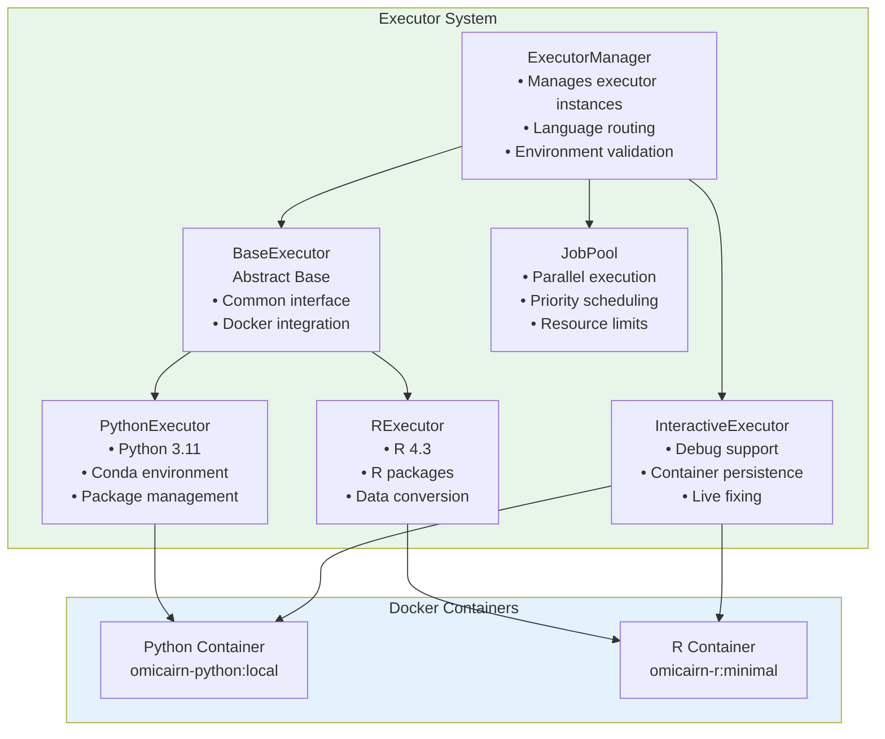

# Job Executor Architecture

> Note: Docker image names in this document (`omicairn-python:local`, `omicairn-r:minimal`) are local tags. Images are built
> locally from the Dockerfiles in `docker/` (see `docker/build.sh`); they are not pulled from a public registry.
> The environment variables and `EXECUTOR_CONFIG` shown under *Configuration* are illustrative; the implemented
> settings live in `config.py`.

## Overview

The job executor system manages the execution of function blocks within Docker containers. It provides a flexible, language-agnostic execution environment with support for Python and R code, interactive debugging, and parallel execution.

## Architecture Diagram



## Core Components

### 1. ExecutorManager (`job_executors/executor_manager.py`)

**Purpose**: Central manager for all executor instances and execution coordination.

**Key Responsibilities**:
- Initialize and manage language-specific executors
- Route function blocks to appropriate executors
- Validate Docker environment
- Manage executor lifecycle

**Key Methods**:
- `get_executor(function_block_type)`: Get executor for specific language
- `execute_function_block()`: Execute a function block
- `validate_environment()`: Check Docker and image availability
- `cleanup()`: Clean up resources

### 2. BaseExecutor (`job_executors/base_executor.py`)

**Purpose**: Abstract base class defining the executor interface.

**Key Responsibilities**:
- Define common executor interface
- Handle Docker container lifecycle
- Manage temporary directories
- Provide execution framework

**Abstract Methods**:
- `block_type`: Function block type handled
- `docker_image`: Docker image to use
- `prepare_execution_dir()`: Prepare execution environment
- `get_execution_command()`: Get container execution command

**Common Methods**:
- `execute()`: Main execution method
- `_run_container()`: Run Docker container
- `_collect_outputs()`: Collect execution results
- `cleanup()`: Clean up temporary files

### 3. PythonExecutor (`job_executors/python_executor.py`)

**Purpose**: Execute Python function blocks with conda environment management.

**Key Features**:
- Python 3.11 environment
- Conda package management
- Automatic dependency installation
- H5AD file support for single-cell data
- Comprehensive error handling

**Docker Image**: `omicairn-python:local`

**Execution Flow**:
1. Prepare workspace with code and data
2. Install requirements via conda/pip
3. Execute function_block.py
4. Collect outputs and logs

### 4. RExecutor (`job_executors/r_executor.py`)

**Purpose**: Execute R function blocks with proper data conversion.

**Key Features**:
- R 4.3 environment
- Automatic H5AD to RDS conversion
- R package installation
- Seurat object support
- Data type preservation

**Docker Image**: `omicairn-r:minimal`

**Execution Flow**:
1. Convert input data (H5AD → RDS)
2. Prepare R environment
3. Install R packages
4. Execute function_block.r
5. Convert outputs (RDS → H5AD)

### 5. InteractiveExecutor (`job_executors/interactive_executor.py`)

**Purpose**: Support interactive debugging within containers.

**Key Features**:
- Container persistence between attempts
- In-container debugging
- Live code modification
- State preservation
- Integration with bug fixer

**Key Components**:
- `execute_with_debugging()`: Main execution with debug support
- `InContainerDebugSession`: Bridge to bug fixer
- `ContainerActionHandler`: Execute debug actions

### 6. JobPool (`job_executors/job_pool.py`)

**Purpose**: Manage parallel execution of multiple jobs.

**Key Features**:
- Configurable parallelism limits
- Priority-based scheduling
- Dependency resolution
- Completion callbacks
- Resource management

**Configuration**:
```python
JobPool(
    max_parallel_jobs=3,      # Maximum concurrent jobs
    executor_type="thread",   # "thread" or "process"
    enable_callbacks=True,    # Enable completion callbacks
    callback_timeout=30.0     # Callback timeout
)
```

## Execution Models

### 1. Standard Execution

Used for normal function block execution:

```python
executor = executor_manager.get_executor(FunctionBlockType.PYTHON)
result = executor.execute(
    function_block=block,
    input_data_path=input_path,
    output_dir=output_dir,
    parameters=params
)
```

### 2. Interactive Debugging

Used when bug fixing is needed:

```python
interactive_executor = InteractiveExecutor(docker_manager, bug_fixer)
result = interactive_executor.execute_with_debugging(
    function_block=block,
    input_data_path=input_path,
    output_dir=output_dir,
    max_debug_attempts=3
)
```

### 3. Parallel Execution

Used by orchestrator for tree execution:

```python
job_pool.submit_job(
    job_id=node.id,
    job_func=executor.execute,
    kwargs=execution_kwargs,
    priority=node.level,
    dependencies=parent_jobs
)
```

## Container Environment

### Python Container

**Base Image**: `python:3.11-slim`

**Pre-installed Packages**:
- conda/mamba for package management
- Common scientific packages (numpy, pandas, scipy)
- Single-cell packages (scanpy, anndata)
- Visualization (matplotlib, seaborn)

**Working Directory**: `/workspace/`

### R Container

**Base Image**: `r-base:4.3`

**Pre-installed Packages**:
- Seurat for single-cell analysis
- Data manipulation (dplyr, tidyr)
- Visualization (ggplot2)
- H5AD conversion utilities

**Working Directory**: `/workspace/`

## File Organization

### Execution Directory Structure

```
execution_dir/
├── function_block.py/r     # Function code
├── requirements.txt        # Dependencies
├── parameters.json         # Execution parameters
├── input/
│   └── _node_anndata.h5ad  # Input data
├── output/
│   ├── _node_anndata.h5ad  # Output data
│   └── figures/            # Generated plots
└── logs/
    ├── stdout.txt          # Standard output
    └── stderr.txt          # Standard error
```

### Job Directory Structure

```
node_dir/jobs/
├── job_TIMESTAMP_ID/
│   ├── execution_summary.json
│   ├── input/              # Copy of input
│   ├── output/             # Execution outputs
│   └── logs/               # Execution logs
└── latest -> job_TIMESTAMP_ID  # Symlink
```

## Error Handling

### Validation Errors

Pre-execution validation catches:
- Missing dependencies
- Invalid input data
- Syntax errors
- Configuration issues

### Runtime Errors

During execution:
- Container failures
- Package installation errors
- Code execution errors
- Resource exhaustion

### Recovery Strategies

1. **Automatic Retry**: Transient failures
2. **Bug Fixer Integration**: Code errors
3. **Fallback Options**: Alternative implementations
4. **Clear Error Reporting**: Detailed diagnostics

## Performance Optimization

### Resource Management

- **CPU Limits**: Configurable per container
- **Memory Limits**: Prevent OOM errors
- **Disk Usage**: Automatic cleanup
- **Network**: Isolated by default

### Caching

- **Docker Images**: Pre-built and cached
- **Package Installation**: Cached in images
- **Intermediate Results**: Preserved in jobs

### Parallel Execution

- **Job Pool**: Concurrent execution
- **Resource Sharing**: Efficient CPU usage
- **Priority Scheduling**: Important jobs first

## Configuration

### Environment Variables

```bash
# Docker settings
OMICAIRN_DOCKER_MEMORY_LIMIT=8g
OMICAIRN_DOCKER_CPU_LIMIT=4

# Execution settings
OMICAIRN_MAX_PARALLEL_JOBS=3
OMICAIRN_EXECUTION_TIMEOUT=1800

# Debug settings
OMICAIRN_ENABLE_INTERACTIVE_DEBUG=true
OMICAIRN_SAVE_EXECUTION_LOGS=true
```

### Config File

```python
# config.py
EXECUTOR_CONFIG = {
    "python": {
        "image": "omicairn-python:local",
        "memory_limit": "8g",
        "cpu_limit": 4
    },
    "r": {
        "image": "omicairn-r:minimal", 
        "memory_limit": "8g",
        "cpu_limit": 4
    },
    "execution": {
        "timeout": 1800,
        "max_retries": 3,
        "cleanup_on_success": True
    }
}
```

## Best Practices

### 1. Resource Management

- Set appropriate memory/CPU limits
- Clean up temporary files
- Monitor disk usage
- Use job pools for parallelism

### 2. Error Handling

- Validate inputs before execution
- Capture all logs
- Provide clear error messages
- Enable debugging when needed

### 3. Performance

- Pre-build Docker images
- Cache package installations
- Use parallel execution
- Minimize data copying

### 4. Debugging

- Enable interactive mode for development
- Save all execution artifacts
- Use structured logging
- Integrate with bug fixer

## Future Enhancements

### Planned Features

1. **GPU Support**: CUDA-enabled containers
2. **Distributed Execution**: Multi-node support
3. **Advanced Scheduling**: Resource-aware scheduling
4. **Execution Profiling**: Performance analytics
5. **Container Registries**: Private registry support

### Extension Points

1. **New Languages**: Add Julia, MATLAB executors
2. **Cloud Backends**: AWS Batch, Google Cloud Run
3. **Monitoring**: Prometheus metrics
4. **Security**: Enhanced isolation options
5. **Workflow Engines**: Nextflow, Snakemake integration