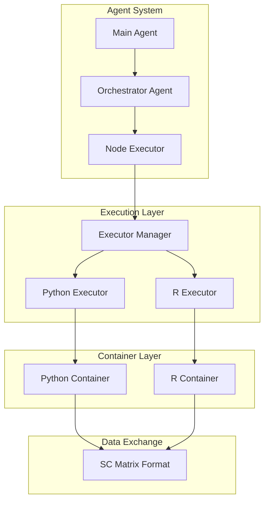

# R/Python Interoperability System

This document describes the R/Python interoperability system, including container architecture, builtin conversion function blocks, and implementation details.

## Table of Contents
1. [Overview](#overview)
2. [Container Architecture](#container-architecture)
3. [Builtin Conversion Function Blocks](#builtin-conversion-function-blocks)
4. [Data Conversion Format](#data-conversion-format)
5. [Implementation Details](#implementation-details)
6. [Testing](#testing)
7. [Performance Considerations](#performance-considerations)

## Overview

The OmiCairn agent system provides interoperability between R and Python code execution through:

1. **Containerized Execution**: Docker containers for isolated, reproducible environments
2. **Builtin Conversion Blocks**: Pre-built function blocks for format conversion between Python and R
3. **Shared Data Format**: SC matrix format for efficient data exchange
4. **Unified Interface**: Common execution patterns for both languages

**Note**: The system does NOT automatically insert conversion nodes. If format conversion is needed between Python and R nodes, the orchestrator may suggest using builtin conversion function blocks, or users can explicitly reference them in their analysis plan.

## Container Architecture

### Docker Images

The system uses specialized Docker images for each language:

**Python Image** (`docker/Dockerfile.python`):
- Base: Ubuntu 22.04
- Python 3.10 with scientific computing libraries
- Pre-installed: numpy, pandas, scanpy, anndata
- Optimized for single-cell analysis

**R Images**:
- `Dockerfile.r.minimal`: Lightweight with essential packages
- `Dockerfile.r.seurat`: Seurat-specific environment
- `Dockerfile.r`: Full R environment with Bioconductor

### Execution Flow



### Directory Structure

Each execution creates a workspace with:
```
execution_dir/
├── input/
│   └── [input files]
├── output/
│   ├── _node_output.[h5ad|rds]
│   └── figures/
├── function_block.[py|R]
├── requirements.txt (Python) / install_packages.R (R, auto-generated)
└── run.[py|R]
```

## Builtin Conversion Function Blocks

The system provides pre-built conversion function blocks in `function_blocks/builtin/`:

### Available Conversion Blocks

1. **convert_anndata_to_sc_matrix**
   - Type: Python
   - Input: AnnData (.h5ad files)
   - Output: Shared SC matrix format (`_node_sc_matrix/` directory)
   - Purpose: Prepare Python data for R processing

2. **convert_sc_matrix_to_anndata**
   - Type: Python
   - Input: Shared SC matrix format
   - Output: AnnData (.h5ad file)
   - Purpose: Convert shared format back to Python

3. **convert_seurat_to_sc_matrix**
   - Type: R
   - Input: Seurat object (.rds files)
   - Output: Shared SC matrix format (`_node_sc_matrix/` directory)
   - Purpose: Prepare R data for Python processing

4. **convert_sc_matrix_to_seuratobject**
   - Type: R
   - Input: Shared SC matrix format
   - Output: Seurat object (.rds file)
   - Purpose: Convert shared format back to R

### How to Use Conversion Blocks

**Option 1: Orchestrator Suggestion**
When planning analysis trees, the orchestrator may suggest using conversion blocks when switching between Python and R:
```
User: "Analyze with scanpy, then cluster with Seurat"
Orchestrator suggests:
  1. Python node: scanpy preprocessing
  2. Python node: convert_anndata_to_sc_matrix
  3. R node: Seurat clustering
```

**Option 2: Explicit Reference**
Users can explicitly request conversion in their analysis plan:
```
User: "Load data with scanpy, convert to shared format, then use Seurat for clustering"
```

## Data Conversion Format

### SC Matrix Format

The shared SC matrix format consists of:

```
_node_sc_matrix/
├── X.mtx                  # Sparse matrix in Matrix Market format
├── obs_names.txt          # Cell identifiers (one per line)
├── var_names.txt          # Gene names (one per line)
├── metadata.json          # Format metadata
└── obs/                   # Cell metadata (optional)
    ├── cluster.csv
    └── cell_type.csv
```

### Python to R Conversion Example

```python
def run(path_dict, params):
    """Convert AnnData to SC matrix format."""
    import json
    import anndata
    import scipy.io
    from pathlib import Path

    # Load AnnData
    input_dir = Path(path_dict['input_dir'])
    h5ad_files = list(input_dir.glob('*.h5ad'))
    adata = anndata.read_h5ad(h5ad_files[0])

    # Create SC matrix directory
    output_dir = Path(path_dict['output_dir'])
    sc_matrix_dir = output_dir / '_node_sc_matrix'
    sc_matrix_dir.mkdir(exist_ok=True)

    # Save matrix
    scipy.io.mmwrite(str(sc_matrix_dir / 'X.mtx'), adata.X)

    # Save obs/var names
    with open(sc_matrix_dir / 'obs_names.txt', 'w') as f:
        for name in adata.obs_names:
            f.write(f"{name}\n")

    with open(sc_matrix_dir / 'var_names.txt', 'w') as f:
        for name in adata.var_names:
            f.write(f"{name}\n")

    # Save metadata
    metadata = {
        "source": "anndata",
        "shape": list(adata.shape)
    }
    json.dump(metadata, open(sc_matrix_dir / 'metadata.json', 'w'))
```

### R to Python Conversion Example

```r
run <- function(path_dict, params) {
    library(Seurat)
    library(Matrix)
    library(jsonlite)

    # Load Seurat object
    input_dir <- path_dict$input_dir
    rds_files <- list.files(input_dir, pattern = "\\.rds$", full.names = TRUE)
    seurat_obj <- readRDS(rds_files[1])

    # Create SC matrix directory
    output_dir <- path_dict$output_dir
    sc_matrix_dir <- file.path(output_dir, "_node_sc_matrix")
    dir.create(sc_matrix_dir, showWarnings = FALSE)

    # Extract and save matrix
    counts <- GetAssayData(seurat_obj, assay = "RNA", slot = "counts")
    writeMM(counts, file.path(sc_matrix_dir, "X.mtx"))

    # Save obs/var names
    writeLines(colnames(counts), file.path(sc_matrix_dir, "obs_names.txt"))
    writeLines(rownames(counts), file.path(sc_matrix_dir, "var_names.txt"))

    # Save metadata
    metadata <- list(
        source = "seurat",
        shape = c(ncol(counts), nrow(counts))
    )
    write_json(metadata, file.path(sc_matrix_dir, "metadata.json"))
}
```

## Implementation Details

### Executor Manager

The `ExecutorManager` routes execution to appropriate language executors:

```python
class ExecutorManager:
    def execute(self, function_block, input_data_path, output_dir, parameters):
        if function_block.type == FunctionBlockType.PYTHON:
            return self.python_executor.execute(...)
        elif function_block.type == FunctionBlockType.R:
            return self.r_executor.execute(...)
```

### Node Executor

The `NodeExecutor` manages the execution lifecycle:

1. Creates execution directory structure
2. Copies input data (from parent or initial input)
3. Prepares function block and dependencies
4. Executes via Docker container
5. Collects outputs and logs
6. Updates node state

### R Package Installation

The R executor handles package installation differently than Python:

1. **No physical requirements.txt file** - Dependencies stored in function block's `requirements` field
2. **Auto-generated install_packages.R** - Created dynamically from requirements
3. **Smart package detection**:
   - Plain names (e.g., `Seurat`) → `install.packages()` from CRAN
   - `Bioconductor::package` → `BiocManager::install()`
   - `user/repo` format → `remotes::install_github()`

Example requirements field:
```
Seurat
ggplot2
Bioconductor::DESeq2
satijalab/seurat-data
```

Generated install_packages.R:
```r
#!/usr/bin/env Rscript
# Ensure BiocManager is installed
if (!requireNamespace("BiocManager", quietly = TRUE))
    install.packages("BiocManager", repos="https://cloud.r-project.org")

# Ensure remotes is installed for GitHub packages
if (!requireNamespace("remotes", quietly = TRUE))
    install.packages("remotes", repos="https://cloud.r-project.org")

# Install packages
install.packages("Seurat", repos="https://cloud.r-project.org")
install.packages("ggplot2", repos="https://cloud.r-project.org")
BiocManager::install("DESeq2")
remotes::install_github("satijalab/seurat-data")
```

### Docker Manager

Handles container lifecycle:
- Creates containers with resource limits
- Mounts volumes for data exchange
- Captures stdout/stderr logs
- Enforces timeouts
- Cleans up after execution

## Testing

### Integration Tests

The system includes comprehensive tests for:

1. **Basic Conversion**: Tests for individual conversion blocks
2. **Docker Execution**: Tests for container-based execution
3. **Complete Workflow**: End-to-end tests with Python→R→Python pipelines

### Test Data

- Python: `test_data/test_data.h5ad` (AnnData format)
- R: `test_data/pbmc3k_seurat_object.rds` (Seurat format)

### Running Tests

```bash
# Test Python executor
pytest tests/test_python_executor.py -v

# Test R executor
pytest tests/test_r_executor.py -v

# Test interoperability (requires LLM)
pytest tests/llm_required/test_r_python_interop.py -v
```

## Performance Considerations

### Optimization Strategies

1. **Sparse Matrix Format**: Efficient for single-cell data
2. **Streaming I/O**: Large files processed in chunks
3. **Parallel Execution**: Multiple conversions run concurrently
4. **Caching**: Converted data cached when possible

### Benchmarks

> Rough, unbenchmarked indications from early development; these are not reported results.

Typical conversion times:
- Small dataset (< 10k cells): < 5 seconds
- Medium dataset (10k-100k cells): 10-30 seconds
- Large dataset (> 100k cells): 1-5 minutes

### Memory Usage

For sparse single-cell data, the SC matrix format typically needs a small fraction of the memory required by dense formats, making it suitable for large-scale single-cell datasets.

## Best Practices

1. **Use Explicit Conversion**: When planning mixed Python/R workflows, explicitly include conversion nodes in your plan
2. **Preserve Metadata**: Ensure critical metadata is preserved during conversion
3. **Test with Real Data**: Validate conversion blocks with your specific dataset types
4. **Monitor Memory**: Large datasets may require memory-efficient conversion strategies

## Future Enhancements

1. **Direct Format Support**: Skip conversion for compatible formats
2. **Streaming Conversion**: Process data without full memory load
3. **Format Detection**: Automatic input format detection
4. **Metadata Preservation**: Enhanced metadata mapping between formats
5. **GPU Acceleration**: CUDA support for large matrix operations
