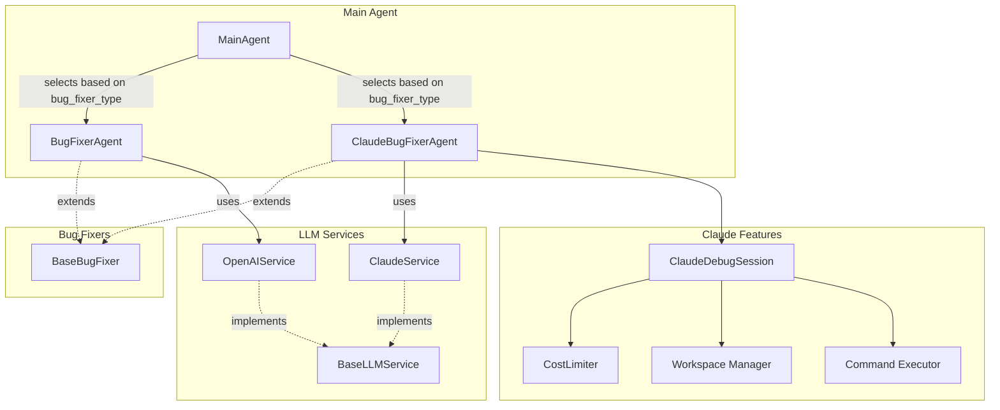
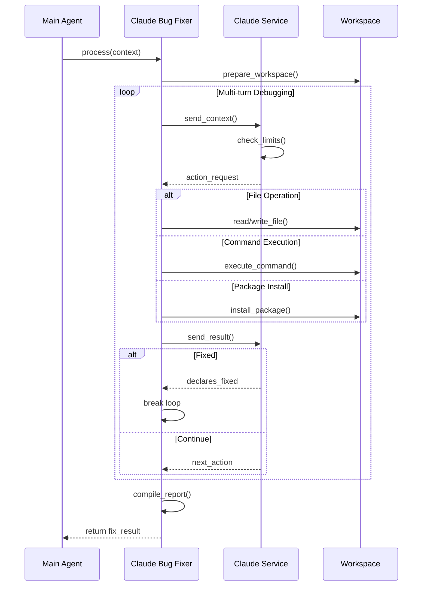

# Claude Bug Fixer Implementation Plan

## Logging and Monitoring

### Claude Bug Fixer Logs

The Claude bug fixer provides comprehensive logging at multiple levels:

#### 1. **Node-Level Logging** (Existing)
Each bug fix attempt is logged in the node directory:
```
nodes/node_<id>/agent_tasks/claude_bug_fixer/bug_fixes/fix_attempt_01_<timestamp>.json
```

This includes:
- Complete multi-turn conversation history
- Each action taken by Claude (read_file, write_file, execute_command, etc.)
- Action results and Claude's reasoning
- Total cost and token usage per attempt
- Final fixed code and requirements

#### 2. **Claude Debugging Reports** (New)
When Claude successfully debugs an issue, a detailed report is saved:
```
nodes/node_<id>/claude_debugging/attempt_<n>_report.json
```

This report contains:
- Number of debugging turns/iterations
- Total cost for the debugging session
- Model used
- Changes made during debugging
- Success/failure status

#### 3. **Main Agent Summary** (New)
The main agent now tracks Claude usage across the entire analysis:
```json
{
  "claude_usage": {
    "total_cost": 0.0123,
    "total_tokens": 45678,
    "model": "claude-3-haiku-20240307"
  }
}
```

### Example Claude Debug Log

```json
{
  "task_id": "fix_attempt_01",
  "agent": "claude_bug_fixer",
  "llm_output": {
    "success": true,
    "iterations": 5,
    "total_cost": 0.0029,
    "model_used": "claude-3-haiku-20240307",
    "turns": [
      {
        "turn": 1,
        "request": "Function Block: data_loading...",
        "response": {
          "action": {
            "type": "read_file",
            "path": "function_block.py"
          },
          "reasoning": "Need to understand the error"
        },
        "action_result": {
          "success": true,
          "content": "..."
        }
      }
    ],
    "final_code": "...",
    "summary": "Fixed sparse matrix handling"
  }
}
```

## Implementation Status

**Last Updated**: 2025-08-07

### Completed Components ✅
1. **Claude Service** (`llm_service/claude_service.py`)
   - Basic chat completion
   - JSON response handling  
   - Cost tracking and calculation
   - Multi-turn conversation support
   - Token usage tracking

2. **Claude Bug Fixer Agent** (`agents/claude_code_sdk_bug_fixer.py`)
   - Multi-turn debugging session management
   - Full container access with file/command operations
   - Workspace preparation and cleanup
   - Cost and token limits enforcement
   - Comprehensive debug reporting

3. **Main Agent Integration**
   - Added Claude API key support
   - Bug fixer type selection (standard/claude)
   - Claude-specific parameters (max_turns, max_cost, max_tokens)
   - Bug fix history tracking for Claude attempts

4. **Testing**
   - Unit and integration tests for the Claude service and bug fixer were written during development
     (these specific test files are not included in this release; see `tests/` for the tests that are)

### Known Issues 🐛
1. **JSON Response Parsing**: Claude sometimes returns non-JSON responses despite explicit instructions
   - Mitigation: Added better error handling and logging
   - Future work: Consider using tool/function calling for more reliable JSON

### Usage Example
```python
# Create main agent with Claude bug fixer
main_agent = MainAgent(
    openai_api_key=config.openai_api_key,
    claude_api_key=config.claude_api_key,
    bug_fixer_type="claude"
)

# Run analysis with Claude-specific parameters
result = main_agent.run_analysis(
    input_data_path="data.h5ad",
    user_request="...",
    output_dir="results/",
    max_claude_turns=5,
    max_claude_cost=0.10,
    max_claude_tokens=50000
)
```

## Overview

The Claude Bug Fixer (fixer-claude) is an enhanced debugging agent that leverages Anthropic's Claude API and Claude Code SDK to provide multi-turn, iterative bug fixing with full container access. This document outlines the implementation plan, architecture, and key features.

## Architecture

### Component Structure



### File Structure

```
llm_service/
├── __init__.py
├── openai_service.py
├── claude_service.py          # NEW: Claude/Anthropic service
└── base_llm_service.py        # NEW: Abstract base for extensibility

agents/
├── __init__.py
├── bug_fixer_agent.py
├── claude_bug_fixer_agent.py  # NEW: Claude-powered bug fixer
└── base_bug_fixer.py          # NEW: Shared interface
```

## Key Components

### 1. Claude Service (`llm_service/claude_service.py`)

```python
class ClaudeService:
    def __init__(self, api_key: str, model: str = "claude-3-haiku-20240307"):
        """Initialize with Anthropic SDK."""
        self.api_key = api_key
        self.model = model
        self.client = anthropic.Anthropic(api_key=api_key)
        self.total_tokens_used = 0
        self.total_cost = 0.0
```

#### Key Methods:
- `calculate_cost()`: Calculates API costs based on model pricing
- `chat_completion()`: Single-turn chat with cost tracking
- `multi_turn_conversation()`: Generator-based multi-turn support

#### Pricing Structure:
| Model | Input (per 1M tokens) | Output (per 1M tokens) |
|-------|----------------------|------------------------|
| Claude 3 Haiku | $0.25 | $1.25 |
| Claude 3 Sonnet | $3.00 | $15.00 |
| Claude 3 Opus | $15.00 | $75.00 |

### 2. Claude Bug Fixer Agent (`agents/claude_bug_fixer_agent.py`)

```python
class ClaudeBugFixerAgent(BaseBugFixer):
    def process(self, context: Dict[str, Any]) -> Dict[str, Any]:
        """Fix using Claude Code SDK with full container access."""
```

#### Hyperparameters:
- `max_claude_turns`: Maximum debugging iterations (default: 5)
- `max_claude_cost`: Maximum cost limit in USD (default: $0.10)
- `max_claude_tokens`: Maximum total tokens (default: 50,000)

#### Capabilities:
- Full file system access within container
- Command execution (Python, pip, pytest, etc.)
- Package installation
- Iterative testing and fixing

### 3. Multi-Turn Debugging Flow



## Features

### 1. Cost and Token Management

```python
class CostLimiter:
    def __init__(self, max_cost: float, max_tokens: int):
        self.max_cost = max_cost
        self.max_tokens = max_tokens
        self.current_cost = 0.0
        self.current_tokens = 0
        
    def check_limits(self) -> Tuple[bool, str]:
        """Check if limits exceeded."""
```

### 2. Claude Debug Session

The `ClaudeDebugSession` class manages the debugging environment with:

- **File Operations**: Read, write, create, delete files
- **Command Execution**: Run Python scripts, tests, shell commands
- **Package Management**: Install/update dependencies
- **State Tracking**: Track all actions for reporting

### 3. Action Types

| Action | Description | Example |
|--------|-------------|---------|
| `read_file` | Read file contents | `{"type": "read_file", "path": "function_block.py"}` |
| `write_file` | Write/modify file | `{"type": "write_file", "path": "...", "content": "..."}` |
| `execute_command` | Run shell command | `{"type": "execute_command", "command": "python test.py"}` |
| `install_package` | Install Python package | `{"type": "install_package", "package": "numpy>=1.20"}` |

## JSON Report Format

```json
{
    "success": true,
    "iterations": 3,
    "total_cost": 0.0234,
    "total_tokens": {
        "input": 12500,
        "output": 3200,
        "total": 15700
    },
    "model_used": "claude-3-haiku-20240307",
    "turns": [
        {
            "turn": 1,
            "actions": ["read_file", "analyze_error"],
            "findings": "Missing import statement for numpy",
            "changes": ["Added 'import numpy as np'"],
            "cost": 0.0078,
            "tokens": {"input": 4200, "output": 1100}
        },
        {
            "turn": 2,
            "actions": ["execute_command", "read_file"],
            "findings": "KeyError in data processing",
            "changes": ["Fixed column name reference"],
            "cost": 0.0089,
            "tokens": {"input": 4100, "output": 1050}
        },
        {
            "turn": 3,
            "actions": ["execute_command"],
            "findings": "All tests passing",
            "changes": [],
            "cost": 0.0067,
            "tokens": {"input": 4200, "output": 1050}
        }
    ],
    "changes_made": [
        {
            "file": "function_block.py",
            "type": "modify",
            "description": "Added missing numpy import"
        },
        {
            "file": "function_block.py",
            "type": "modify",
            "description": "Fixed KeyError by using correct column name"
        }
    ],
    "final_code": "def run(path_dict, params):\n    import numpy as np\n    ...",
    "final_requirements": "numpy>=1.20\npandas>=1.3",
    "test_results": {
        "passed": true,
        "output": "All tests passed successfully"
    },
    "debug_log": [
        "[Turn 1] Analyzing error: ImportError for numpy",
        "[Turn 1] Adding import statement",
        "[Turn 2] Running test, found KeyError",
        "[Turn 2] Fixed column reference",
        "[Turn 3] All tests passing"
    ]
}
```

## Integration with Main Agent

### Initialization

```python
# In main_agent.py
def __init__(self, 
             openai_api_key: Optional[str] = None, 
             claude_api_key: Optional[str] = None,
             bug_fixer_type: str = "standard",
             llm_model: Optional[str] = None):
    """Initialize with bug fixer type selection."""
    
    # Initialize services
    self.llm_service = OpenAIService(api_key=openai_api_key, model=llm_model) if openai_api_key else None
    self.claude_service = ClaudeService(api_key=claude_api_key) if claude_api_key else None
    
    # Select bug fixer based on type
    if bug_fixer_type == "claude" and self.claude_service:
        self.bug_fixer = ClaudeBugFixerAgent(self.claude_service)
    elif self.llm_service:
        self.bug_fixer = BugFixerAgent(self.llm_service)
```

### Usage Example

```python
# Create main agent with Claude bug fixer
agent = MainAgent(
    openai_api_key=os.getenv("OPENAI_API_KEY"),
    claude_api_key=os.getenv("CLAUDE_API_KEY"),
    bug_fixer_type="claude"
)

# Run analysis with Claude-specific parameters
result = agent.run_analysis(
    input_data_path="data/test.h5ad",
    user_request="Run pseudotime analysis",
    output_dir="output/",
    max_claude_turns=10,      # Allow more turns for complex bugs
    max_claude_cost=0.50,     # Higher budget for thorough debugging
    max_claude_tokens=100000  # More tokens for extensive fixes
)
```

## Configuration

### Environment Variables

```bash
# .env file
CLAUDE_API_KEY=<YOUR_CLAUDE_API_KEY>
CLAUDE_DEFAULT_MODEL=claude-3-haiku-20240307
CLAUDE_MAX_TURNS=5
CLAUDE_MAX_COST=0.10
CLAUDE_MAX_TOKENS=50000
```

### Configuration Object

```python
CLAUDE_CONFIG = {
    "default_model": "claude-3-haiku-20240307",
    "default_max_turns": 5,
    "default_max_cost": 0.10,
    "default_max_tokens": 50000,
    "timeout_per_turn": 60,  # seconds
    "allowed_commands": ["python", "pip", "pytest", "ls", "cat", "echo"],
    "workspace_cleanup": True,
    "save_debug_logs": True
}
```

## Extensibility

### Future Features

1. **Real-time Streaming**
   - Methods return generators/async iterators
   - WebSocket support for live updates
   - Progress callbacks

2. **Plugin System**
   ```python
   class ClaudeActionPlugin:
       def can_handle(self, action_type: str) -> bool:
           pass
       
       def execute(self, action: Dict) -> Dict:
           pass
   ```

3. **Event System**
   ```python
   claude_fixer.on('turn_start', callback)
   claude_fixer.on('action_executed', callback)
   claude_fixer.on('fix_complete', callback)
   ```

4. **Custom Tools**
   - Database queries
   - API calls
   - External service integration

## Testing Strategy

### Test Cases

```python
# Intentionally buggy function blocks
test_cases = {
    "missing_import": "Code missing required imports",
    "wrong_api_usage": "Incorrect library API usage",
    "complex_logic_error": "Subtle logic bugs",
    "dependency_conflict": "Package version conflicts",
    "type_errors": "Type mismatches",
    "async_issues": "Async/await problems"
}
```

### Performance Comparison

```python
def compare_bug_fixers(test_case):
    # Run with standard bug fixer
    standard_result = standard_bug_fixer.process(test_case)
    
    # Run with Claude bug fixer
    claude_result = claude_bug_fixer.process(test_case)
    
    # Compare metrics
    return {
        "test_case": test_case,
        "standard": {
            "success": standard_result['success'],
            "attempts": standard_result.get('attempts', 1),
            "time": standard_result.get('duration')
        },
        "claude": {
            "success": claude_result['success'],
            "iterations": claude_result['claude_report']['iterations'],
            "cost": claude_result['claude_report']['total_cost'],
            "time": claude_result.get('duration')
        }
    }
```

## Implementation Phases

### Phase 1: Basic Implementation (Week 1)
- [ ] Create `claude_service.py` with basic chat functionality
- [ ] Implement cost calculation
- [ ] Create `claude_bug_fixer_agent.py` with single-turn fixing
- [ ] Add main agent integration

### Phase 2: Multi-turn Support (Week 2)
- [ ] Implement multi-turn conversation in Claude service
- [ ] Add workspace management
- [ ] Implement file operations
- [ ] Add basic command execution

### Phase 3: Full Features (Week 3)
- [ ] Complete all action types
- [ ] Add comprehensive error handling
- [ ] Implement cost/token limiters
- [ ] Create detailed JSON reporting

### Phase 4: Testing & Optimization (Week 4)
- [ ] Create test suite with buggy examples
- [ ] Performance comparison with standard fixer
- [ ] Optimize prompts and strategies
- [ ] Documentation and examples

## Security Considerations

Generated and LLM-modified code runs only inside isolated Docker containers. This is a research prototype: do not
run it on untrusted input or with production credentials. Safeguards include:

- Container isolation
- Workspace directory restrictions
- Command allowlist (optional)
- Timeout limits
- Resource limits (CPU, memory)

## Monitoring and Debugging

### Debugging Claude Bug Fixer

To debug Claude bug fixer issues, check these locations:

1. **Bug Fix Attempts**: 
   ```bash
   # View all fix attempts for a node
   ls -la results/<tree_id>/nodes/node_<id>/agent_tasks/claude_bug_fixer/bug_fixes/
   
   # View specific attempt details
   cat results/<tree_id>/nodes/node_<id>/agent_tasks/claude_bug_fixer/bug_fixes/fix_attempt_01_*.json
   ```

2. **Claude Debug Reports**:
   ```bash
   # View Claude debugging session reports
   cat results/<tree_id>/nodes/node_<id>/claude_debugging/attempt_1_report.json
   ```

3. **Main Agent Logs**:
   ```bash
   # Check if Claude was used
   grep -r "Claude debugging" results/
   
   # View overall Claude usage
   cat results/benchmark_result.json | jq .claude_usage
   ```

### Common Issues and Solutions

1. **JSON Parsing Errors**
   - **Symptom**: "Failed to parse JSON response"
   - **Cause**: Claude returns non-JSON or multiple JSON objects
   - **Solution**: The implementation now handles multiple formats and extracts JSON from text

2. **Missing Input Data**
   - **Symptom**: Claude can't find input files in workspace
   - **Cause**: Input data path not passed to bug fixer
   - **Solution**: Now automatically copies input files to Claude's workspace

3. **Environment Differences**
   - **Symptom**: Fix works in Claude's test but fails in execution
   - **Cause**: Different package versions or APIs
   - **Solution**: Ensure consistent environments or add version checks

### Logging

```python
# Debug logs saved to
agent_tasks/claude_bug_fixer/debug_logs/
├── session_20240307_120000.log
├── actions_20240307_120000.json
└── conversation_20240307_120000.json
```

### Metrics to Track

- Success rate by error type
- Average cost per fix
- Average iterations needed
- Most common action sequences
- Failure patterns

## Conclusion

The Claude Bug Fixer provides a powerful, flexible debugging solution with:
- Multi-turn iterative fixing
- Full container access
- Comprehensive cost management
- Detailed reporting
- Room for future extensibility

This implementation will significantly enhance the system's ability to handle complex debugging scenarios that require exploration and iteration.