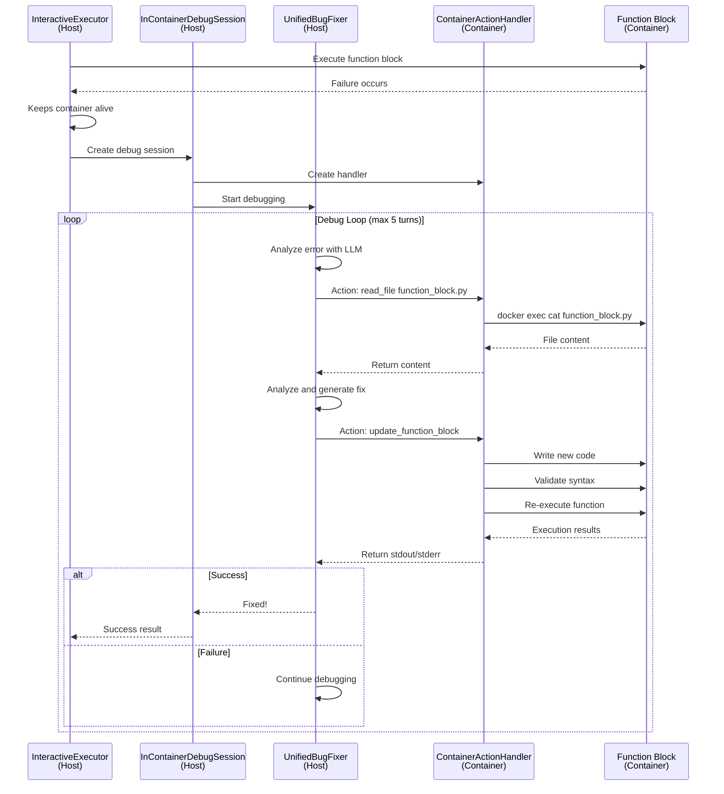

# In-Container Debugging Guide

## Overview

The omicairn agent system supports **in-container debugging**, where the bug fixer runs on the host system but executes all debugging actions inside the Docker container where the error occurred. This hybrid approach provides the best of both worlds: LLM interaction on the host and action execution in the container environment.

## Architecture

### Traditional Approach (Before)
1. Function block executes in Docker container
2. Container exits on error
3. Bug fixer runs in isolated environment
4. Bug fixer cannot access actual data
5. Fixes are based on assumptions

### Current Hybrid Approach
1. Function block executes in Docker container
2. On error, container stays running
3. Bug fixer (on host) analyzes error with LLM
4. Debugging actions execute IN THE CONTAINER via docker exec
5. Bug fixer can inspect actual data files and environment
6. Fixes are based on real data analysis
7. Container persists state between debug attempts

## Key Components

### 1. Interactive Executor (`job_executors/interactive_executor.py`)
- Manages long-running containers
- Executes function blocks with retry capability
- Invokes bug fixer within the container on failure
- Collects results after successful execution

### 2. InContainerDebugSession
- Bridge between host bug fixer and container
- Creates ContainerActionHandler for action execution
- Manages debug session lifecycle
- Clean architecture without monkey-patching

### 3. ContainerActionHandler
- Executes bug fixer actions via docker exec
- Handles file I/O, command execution, and directory listing
- Enhanced update_function_block with automatic re-execution
- Returns structured results to bug fixer on host

### 3. Interactive Node Executor (`analysis_tree_management/interactive_node_executor.py`)
- Extended version of standard node executor
- Integrates with interactive executor for debugging
- Tracks debug attempts in metadata
- Maintains compatibility with existing workflow

### 4. Conda Environment Integration
- Uses Micromamba with dedicated conda environment (`_omicairn_job`)
- Consistent Python environment across all executions
- Better package management and isolation

## Execution Flow

### Debug Session Flow



### Key Architecture Points

1. **Container Persistence**: Container stays alive between debug attempts
2. **State Preservation**: Installed packages and file changes persist
3. **Immediate Feedback**: update_function_block auto-executes and returns results
4. **Clean Architecture**: No monkey-patching, direct session creation
5. **Host-Container Bridge**: InContainerDebugSession manages the connection

## Usage

### Enable In-Container Debugging (Default)

```python
from agents.main_agent import MainAgent

agent = MainAgent(
    openai_api_key="your-key",
    bug_fixer_type="unified",
    enable_interactive_debug=True  # Default: True
)

# Run analysis as usual
result = agent.run_analysis(
    input_data_path="data.h5ad",
    user_request="Perform pseudotime analysis",
    output_dir="results/"
)
```

### Disable In-Container Debugging (Legacy Mode)

```python
agent = MainAgent(
    openai_api_key="your-key",
    enable_interactive_debug=False  # Use traditional debugging
)
```

## Data Exploration Capabilities

### Bug Fixer Data Exploration
The bug fixer can now actively explore data to understand structure:

```python
# Explore data structure
micromamba run -n _omicairn_job python -c "import scanpy as sc; adata = sc.read_h5ad('/workspace/input/_node_anndata.h5ad'); print('Shape:', adata.shape); print('Columns:', list(adata.obs.columns))"

# Check data types and values
micromamba run -n _omicairn_job python -c "print(f'Cell type column dtype: {adata.obs[\"Cell_type\"].dtype}'); print(f'Unique values: {adata.obs[\"Cell_type\"].unique()[:5]}')"
```

### Example: Missing Column Fix

#### Error Scenario
```python
# Function block code
def run(path_dict, params):
    import scanpy as sc
    import os
    
    input_file = os.path.join(path_dict['input_dir'], '_node_anndata.h5ad')
    adata = sc.read_h5ad(input_file)
    
    # This fails if 'cell_type' column doesn't exist
    marker_key = params.get('marker_key', 'cell_type')
    if marker_key not in adata.obs.columns:
        raise ValueError(f"Marker key '{marker_key}' not found in adata.obs")
```

#### In-Container Bug Fix Process

1. **Container executes code** - Fails with ValueError
2. **Bug fixer activates in container**
3. **Inspects actual data**:
   ```python
   micromamba run -n _omicairn_job python -c "import scanpy as sc; adata = sc.read_h5ad('/workspace/input/_node_anndata.h5ad'); print(list(adata.obs.columns))"
   # Output: ['leiden', 'n_genes', 'n_counts']
   ```
4. **Modifies code with fallback**:
   ```python
   # Check available columns
   print(f"Available columns: {list(adata.obs.columns)}")
   
   if marker_key in adata.obs.columns:
       # Use specified marker
       cells = adata.obs[marker_key] == target_value
   else:
       # Fallback to clustering
       if 'leiden' not in adata.obs.columns:
           sc.tl.leiden(adata)
       cluster_counts = adata.obs['leiden'].value_counts()
       smallest_cluster = cluster_counts.idxmin()
       cells = adata.obs['leiden'] == smallest_cluster
   ```
5. **Re-executes in same container** - Succeeds!

## Recent Improvements

### 2025-08-14: Container Architecture Fix
1. **Fixed FileNotFoundError**: Removed monkey-patching approach that caused /workspace access errors
2. **Enhanced update_function_block**: Now automatically re-executes code and returns results
3. **Clean Architecture**: Direct session creation with ContainerActionHandler
4. **Improved Feedback Loop**: Immediate execution results for faster debugging

### 2025-08-11: Data Exploration Enhancements

### 1. Enhanced Bug Fixer Data Exploration
Updated bug fixer prompts to encourage active data exploration instead of assumptions.

### 2. Conversation History Persistence
Bug fixer now receives information from previous debug attempts:
```
Previous Attempts:

Attempt 1:
  - Modified files: function_block.py
  - Finding: Column 'cell_type' not found, data has 'Cell_type'
  - Key actions:
    * execute_command: micromamba run -n _omicairn_job python -c "..."
    * write_file: function_block.py
```

### 3. Module Reload Fix
Python executor now forces module reload between attempts:
```python
# Force reload in case the module was modified by bug fixer
import sys
if 'function_block' in sys.modules:
    del sys.modules['function_block']
    
from function_block import run
```

### 4. Improved Error Tracking
Better collection and display of execution logs with actual Python tracebacks.

## Usage Guidelines

### For Bug Fixer Operations

1. **Always explore data first**:
   ```bash
   micromamba run -n _omicairn_job python -c "import scanpy as sc; adata = sc.read_h5ad('/workspace/input/_node_anndata.h5ad'); print(list(adata.obs.columns))"
   ```

2. **Use conda environment for all Python commands**:
   ```bash
   # Correct
   micromamba run -n _omicairn_job python script.py
   
   # Incorrect (may use system Python)
   python script.py
   ```

3. **Check data types and shapes**:
   ```python
   print(f"Shape: {adata.shape}")
   print(f"Cell type column dtype: {adata.obs['Cell_type'].dtype}")
   print(f"Unique values: {adata.obs['Cell_type'].unique()[:5]}")
   ```

### For Function Block Development

1. **Don't hardcode column names** - let bug fixer discover them
2. **Include data exploration in initial attempts**
3. **Use descriptive error messages** that guide debugging

## Benefits

1. **Accurate Fixes**: Access to real data enables precise solutions
2. **Faster Debugging**: No need to recreate environment
3. **Better Context**: Bug fixer sees actual file structure and data
4. **Reduced Iterations**: Fewer trial-and-error attempts
5. **Persistent Environment**: Package installations and module changes persist

## Limitations

1. **Container Resources**: Long-running containers consume memory
2. **Timeout Constraints**: Containers have execution time limits
3. **Security**: Bug fixer has full container access
4. **Complexity**: More complex architecture to maintain

## Configuration

### Environment Variables
- `OMICAIRN_DEBUG_MODE=true`: Enable debug logging
- `OMICAIRN_INTERACTIVE_DEBUG=true`: Force interactive debugging (planned; not yet read by the code)

### Main Agent Parameters
- `enable_interactive_debug`: Enable/disable in-container debugging
- `max_debug_attempts`: Maximum debug attempts per node (default: 3)

### Bug Fixer Settings
- `enable_web_agent`: Use web agent for research (works with in-container)
- `timeout_seconds`: Web agent timeout (default: 90s)

## Testing

Run the test suite for in-container debugging:

```bash
python tests/integration/test_in_container_bug_fixer.py
```

This tests:
- Container action handler functionality
- Interactive executor with mocked Docker
- Main agent initialization with debugging enabled
- Bug fixer behavior with data access

## Technical Details

### Docker Build Command
```bash
docker build -f docker/Dockerfile.python -t omicairn/python-executor:latest docker/
```

### Python Executor Command
```python
def get_execution_command(self) -> List[str]:
    return [
        "bash", "-c",
        "cd /workspace && " +
        "eval \"$(micromamba shell hook --shell bash)\" && " +
        "micromamba activate _omicairn_job && " +
        "pip install -r requirements.txt && " +
        "python run.py"
    ]
```

## Future Enhancements

1. **Container Pooling**: Reuse containers across nodes
2. **Debug History**: Track successful fixes for learning
3. **Parallel Debugging**: Debug multiple nodes simultaneously
4. **Resource Management**: Better container lifecycle management
5. **Security Sandboxing**: Limit bug fixer capabilities
6. **Caching discovered information** between attempts
7. **Smarter exploration strategies** based on error types
8. **Support for other languages** (R with renv)

## Migration Notes

### For Existing Code

1. **Update Docker images**: Rebuild with new Dockerfile
2. **Update prompts**: Ensure bug fixer prompts mention conda environment
3. **Test data exploration**: Verify bug fixer can access and explore data

### Backwards Compatibility

- Old function blocks continue to work
- Python/pip commands automatically use conda environment
- No changes needed to function block code